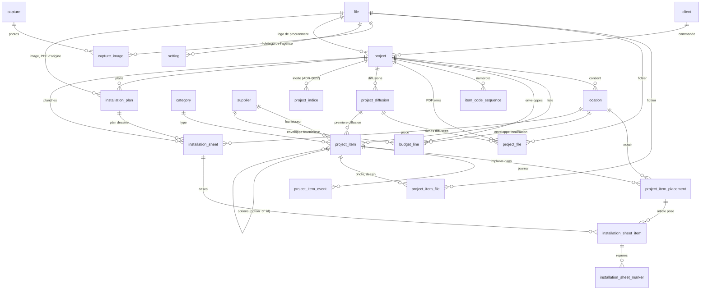

# Modèle de données v1 (recentré, ADR-0013 ; v1 déclarée, ADR-0020)

> **Modèle recentré le 2026-10-12 (ADR-0013)** à partir de la liste de données de l'utilisateur (fiche de spec, listing FF&E, budget). Il remplace le modèle validé à l'étape 2 et enrichi jusqu'à l'étape 11 ; les modules devis, bons de commande, réceptions, factures et import de tarifs sont retirés du code (tag git `v0-complet`). La v1 est déclarée le 2026-10-14 (ADR-0020) : `0001_initial.py` est figée et tout changement de schéma passe par une migration additive (`0002_item_file_finish`, `0003_item_option`, `0004_project_procurement`, `0005_diffusion`, `0006_agency_logo`, `0007_listing_profile`, `0008_installation`, `0009_fk_indexes`) ; ce document fait foi pour les tables, les statuts, les formules et les accroches futures.

Cible : SQLite ≥ 3.37 (tables STRICT), un utilisateur, volumes faibles (centaines d'articles par projet). Accès par SQLAlchemy 2.0.x (`Mapped[]`), migrations Alembic `0001_initial.py` (figée), `0002_item_file_finish.py`, `0003_item_option.py`, `0004_project_procurement.py`, `0005_diffusion.py`, `0006_agency_logo.py`, `0007_listing_profile.py`, `0008_installation.py`, `0009_fk_indexes.py`, validation Pydantic v2 côté API. Aucune marge de revente ; plusieurs devises ; totaux et budgets en EUR HT.

---

## 1. Principe cardinal et vocabulaire

**Référentiel réutilisable** d'un côté, **instance projet** de l'autre.

| Terme | Définition | Tables |
|---|---|---|
| Référentiel | Données partagées entre projets, archivées plutôt que supprimées | `setting`, `client`, `category` (types de produit), `choice` (listes éditables), `professional` (annuaire), `supplier`, `file`, `capture` et `capture_image` (boîte de réception de l'extension), `listing_profile` (colonnes du listing) |
| Instance projet | Ce qu'un projet fige : la fiche de l'article, son prix, sa devise, son taux, son fournisseur, son statut | `project`, `location`, `project_item`, `project_item_placement`, `project_item_event`, `project_item_file`, `budget_line`, `project_diffusion`, `project_file`, `installation_plan`, `installation_sheet`, `installation_sheet_item`, `installation_sheet_marker` (planches d'installation, ADR-0024), `project_indice` (inerte depuis ADR-0022), `item_code_sequence` (inerte depuis ADR-0021) |
| Article (`project_item`) | **Une fiche de prescription** dans un projet : « Beat Light Fat, Flos, réf. BLS01, laiton, Ø 36 × H 30 cm, 1 062,50 GBP HT net ». Porte le prix figé et le statut unique ; ses codes FF&E (`CHA-LUD-01`) sont ceux de ses implantations, un par localisation (ADR-0018) |
| Implantation (`project_item_placement`) | **Un emplacement d'un article** : localisation + quantité par unité. La même lampe dans le lobby (×2) et en chambre typo A (×1, localisation ×12) = un article, deux implantations, quantité totale 14 (exemple suivi en §4.9, §4.10 et §6) |
| Localisation (`location`) | Lieu de destination dans un projet (lobby, bar, chambre typo A, suite…) avec sa **zone** (Zones communes, Hébergement, Back of house…), son **niveau** (R0, R+1…) et son **nombre** (multiplicateur, défaut 1) |
| Frais (`kind = 'fee'`) | Ligne forfaitaire par fournisseur (livraison, emballage…) : comptée dans le budget, sans type, sans implantation, absente des fiches |

Conséquences : pas de catalogue, l'article porte toute sa fiche (ADR-0016) ; un code identifie un article dans une pièce (ADR-0018) ; les totaux sont calculés par `api/src/ffe/money.py`, jamais stockés ; zéro vue SQL ; le front n'additionne jamais.

---

## 2. Diagramme



`choice` (listes famille · usage · prestation) n'a pas de clé étrangère : `project_item.family` / `usage`, `budget_line.family` et `professional.kind` en portent le code, vérifié par le service. `item_code_sequence` (reliée à `project` en CASCADE) n'est plus utilisée (ADR-0021).

---

## 3. Conventions transversales

| Sujet | Règle | Pourquoi / comment |
|---|---|---|
| Nommage | Tables au singulier, snake_case, anglais ; colonnes idem | Cohérent avec le code |
| Identifiants | `id INTEGER PRIMARY KEY` ; codes humains (`project.code`, `item_code`, `location.code`) séparés et éditables | Mono-utilisateur ; lisible |
| Horodatages | `created_at`, `updated_at` TEXT ISO-8601 UTC `2026-10-09T17:03:12Z`, posés par le service avec l'horloge injectée ; jamais `DEFAULT CURRENT_TIMESTAMP` | Tri lexicographique = chronologique ; testable |
| Dates métier | `*_on` TEXT `YYYY-MM-DD` + `CHECK GLOB` | Comparables |
| Argent | `*_cents INTEGER` HT `≥ 0` ; `currency` TEXT ISO 4217 `length = 3` | Pas de flottant |
| Taux | Points de base INTEGER `*_bp`, `BETWEEN 0 AND 10000` | Précision sans flottant |
| Quantités | Millièmes INTEGER `qty_milli` (1 000 = 1 ; 12 500 = 12,5) | Moquette et tringles existent |
| Taux de change | `fx_rate_micro INTEGER` : 1 unité de `currency` = `fx_rate_micro` / 1 000 000 EUR ; `1 000 000` imposé pour l'EUR ; saisi à la main, figé par article, réutilisé par défaut dans le projet | Entier ; aucun appel externe |
| Base de calcul | Totaux et budgets en **EUR** (`setting.base_currency`, `CHECK = 'EUR'`) ; conversion après remise, au prix unitaire net | Un seul référentiel |
| STRICT | Toutes les tables `STRICT` ; types `INTEGER`, `TEXT` seulement | Une insertion mal typée échoue |
| Booléens | `INTEGER NOT NULL DEFAULT 0 CHECK (x IN (0, 1))` | Pas de BOOLEAN en SQLite |
| Statuts et énumérations | `TEXT` + `CHECK (x IN (...))`, miroir d'un `Literal[...]` Pydantic ; pas de CHECK sur `project_item_event.kind` | Un seul endroit à changer ; le journal reste ouvert |
| UNIQUE métier | Jamais de colonne nullable dans un UNIQUE sans `COALESCE` ; index d'expression ou partiels écrits à la main dans la migration | Deux NULL sont distincts pour SQLite |
| FK | `foreign_keys = ON` ; `ON DELETE RESTRICT` partout sauf enfants stricts en `CASCADE` : `project_item_placement`, `project_item_event`, `project_item_file`, `project_diffusion`, `project_indice` (inerte), `capture_image`, `item_code_sequence` (inerte), `installation_sheet_item` (par sa planche et par son implantation), `installation_sheet_marker` ; toute FK a un index (complétés par `0009_fk_indexes`) | Un référentiel utilisé ne disparaît jamais |
| FK composites | `UNIQUE (id, project_id)` sur `project_item`, `location` et `installation_plan` ; implantations, budgets et planches référencent `(x_id, project_id)` | Aucune référence croisée entre projets |
| Archivage | `archived_at` sur `client`, `supplier`, `professional`, `category`, `choice`, `location` ; `project` utilise `status` ; `project_item` le statut `cancelled` | On ne perd jamais une fiche vue par un client |
| Suppression physique bornée | `project_item` : article jamais diffusé (`first_diffusion_id` NULL, donc tout article avant la première diffusion), jamais une base qui a des options (ADR-0021/0022) ; un article diffusé s'annule ; `location` sans implantation ni budget ; `project_item_placement` (jamais la dernière) ; `budget_line` (par le `PUT` en bloc) ; `listing_profile` ; `installation_plan` qu'aucune planche n'utilise ; `installation_sheet` (ses cases et repères avec elle) ; jointures fichier | Règle d'app testée + RESTRICT en filet |
| Fichiers | `file` dédoublonné par `sha256`, stocké `FFE_DATA_DIR/files/<sha256>.<ext>` ; `unlink` seulement si plus rien ne le désigne (`project_item_file`, `project_file`, `capture_image`, logos de `setting` et de `project`, `installation_plan.file_id` et `source_file_id`) | Une seule logique |
| Nommage des contraintes | `naming_convention` SQLAlchemy (`pk_`, `fk_`, `uq_`, `ck_<table>_<nom>`, `ix_`) ; chaque CHECK nommé | Alembic batch exige des noms |
| Migrations | v1 déclarée (ADR-0020) : `0001_initial.py` figée, puis `0002` à `0009` ; additives, relues, jamais éditées | Règles maîtresses : ARCHITECTURE §5 |

---

## 4. Tables

Colonnes communes, non répétées : `id INTEGER PRIMARY KEY`, `created_at`, `updated_at` TEXT NOT NULL (sauf `project_item_event`, `item_code_sequence`, `project_file`, `project_diffusion`, `project_indice`, `capture`, `capture_image`, `installation_sheet_item`, `installation_sheet_marker` ; `file` sans `updated_at`). `notes TEXT NULL` = texte libre interne. `TS` = horodatage, `DATE` = `YYYY-MM-DD`.

### 4.1 `setting` — ligne unique

| Colonne | Type | Null | Défaut | Contrainte | Commentaire |
|---|---|---|---|---|---|
| id | INTEGER | non | 1 | `CHECK (id = 1)` | insérée par la migration |
| base_currency | TEXT | non | `'EUR'` | `= 'EUR'` | |
| seed_category_version | INTEGER | non | 0 | | version du seed des types (`ffe db seed`) |
| project_code_prefix | TEXT | non | `''` | | `'P'` → `P2026-001` |
| agency_name, agency_address, agency_email, agency_phone | TEXT | name non, autres oui | `''` | | `agency_name` : « Réalisé par … » en bas à gauche des fiches et du listing (2026-10-16) ; couverture des fiches |
| agency_logo_file_id | INTEGER | oui | | FK `file` RESTRICT (migration 0006) | logo de l'agence, image déposée dans Réglages, en haut à gauche des fiches ; remplacé → l'ancien fichier quitte le disque s'il n'est plus référencé |
| extension_token | TEXT | oui | | | jeton de l'extension Chrome (ADR-0017), généré sur Réglages ; NULL = extension désactivée |

### 4.2 `client`

`name` (`length > 0`), `kind` (`individual` \| `company`), `contact_name`, `email`, `phone`, `address_line1`, `address_line2`, `postal_code`, `city`, `country_code` (2 lettres, `FR`), `siren` (9 chiffres ou NULL), `notes`, `archived_at`. Inchangée depuis l'étape 3.

### 4.3 `project`

| Colonne | Type | Null | Défaut | Contrainte | Commentaire |
|---|---|---|---|---|---|
| code | TEXT | non | — | `UNIQUE`, `length > 0` | `<préfixe>AAAA-NNN` généré, éditable |
| name | TEXT | non | — | `length > 0` | |
| client_id | INTEGER | non | — | FK `client` RESTRICT | |
| status | TEXT | non | `'prospect'` | `IN ('prospect','active','delivered','closed','cancelled')` | `closed`/`cancelled` = lecture seule |
| site_address | TEXT | oui | | | |
| due_on | DATE | oui | | format date | échéance |
| notes | TEXT | oui | | | |
| procurement_name | TEXT | oui | | | société de procurement pour qui le projet est mené, imprimée en haut à droite des fiches (migration 0004, 2026-10-15) |
| procurement_logo_file_id | INTEGER | oui | | FK `file` RESTRICT (posée par la migration 0004) | son logo : une image déposée (`POST /files`), jamais un PDF (422) ; un logo remplacé est effacé s'il n'est plus utilisé |
| indice, indice_changed_at | TEXT | oui | | | ancien indice déclaré sur le projet (2026-10-13) : **plus lu ni écrit depuis ADR-0022** (indice par code, §7), gardé (v1 additive) |

### 4.4 `location` — localisation (ADR-0013)

| Colonne | Type | Null | Défaut | Contrainte | Commentaire |
|---|---|---|---|---|---|
| project_id | INTEGER | non | — | FK `project` RESTRICT ; `UNIQUE (id, project_id)` | |
| code | TEXT | non | — | `UNIQUE (project_id, code)` ; `length > 0` | `LOB`, `CHA`… premier segment du code FF&E |
| name | TEXT | non | — | `length > 0` | « Chambre typo A », « Lobby » |
| zone | TEXT | oui | | | « Zones communes », « Hébergement », « Back of house » ; texte libre avec suggestions ; axe de budget |
| level | TEXT | oui | | | « R0 », « R+1 » |
| multiplier | INTEGER | non | 1 | `>= 1` | nombre d'exemplaires (24 chambres) |
| sort_order | INTEGER | non | 0 | | |
| archived_at | TS | oui | | | |

### 4.5 `category` — type de produit

| Colonne | Type | Null | Défaut | Contrainte | Commentaire |
|---|---|---|---|---|---|
| code | TEXT | non | — | `UNIQUE` ; 2 à 4 majuscules | `AS`, `TAB`, `LUD`… segment central du code FF&E ; immuable |
| name | TEXT | non | — | `length > 0` ; `UNIQUE lower(name)` (index d'expression) | éditable |
| sort_order | INTEGER | non | 0 | | |
| archived_at | TS | oui | | | |

Un seul niveau. Seed (`ffe db seed`, 21 types, revus le 2026-10-13) : AS Assise, TAB Table, TBR Tabouret, AGE Agencement, LIT Lit, TAP Tapis, RID Rideau, LIN Linge, LUA Luminaire architectural, LUD Luminaire décoratif, MIR Miroir, DEC Décoration, ART Œuvre d'art, ACC Accessoire, ACA Accastillage, QUI Quincaillerie, SAN Sanitaire, SIG Signalétique, REV Revêtement, EQU Équipement, DIV Divers. Le code sert aussi de cible au devinage de type de la capture (`captures/extract.py`, mots-clés).

### 4.6 `professional` — annuaire

Fabricants (artisans et ateliers particuliers), distributeurs, éditeurs de tissu, artisans d'art : un carnet d'adresses, **jamais rattaché** à un produit ni à un article (ADR-0015). Chargé par `ffe db import-contacts <csv>`.

| Colonne | Type | Null | Défaut | Contrainte | Commentaire |
|---|---|---|---|---|---|
| name | TEXT | non | — | `length > 0` ; `UNIQUE lower(name)` | doublon détecté par nom normalisé (409 `duplicate`) |
| kind | TEXT | non | `'manufacturer'` | code d'une liste `choice` (`prestation`) active, vérifié par le service (422) | prestation ; valeurs de départ Fabricant · Distributeur · Éditeur · Artisan (§4.16) |
| specialty | TEXT | oui | | | savoir-faire (Confection, Tapis, Luminaire sur-mesure…) |
| contact_name, phone, mobile, email | TEXT | oui | | | contact 1 |
| contact2_name, contact2_phone, contact2_email | TEXT | oui | | | contact 2 |
| website, notes | TEXT | oui | | | |
| archived_at | TS | oui | | | |

### 4.7 `supplier`

| Colonne | Type | Null | Défaut | Contrainte | Commentaire |
|---|---|---|---|---|---|
| name | TEXT | non | — | `length > 0` | doublon détecté par nom normalisé (409 `duplicate`) |
| specialty | TEXT | oui | | | savoir-faire (Mobilier, Luminaire, Sanitaire…) |
| contact_name, email, phone, mobile | TEXT | oui | | | représentant imprimé sur la fiche de spec (nom, e-mail, téléphone) |
| contact2_name, contact2_phone, contact2_email | TEXT | oui | | | second contact (back office…) |
| website | TEXT | oui | | | |
| currency | TEXT | non | `'EUR'` | `length = 3` | devise par défaut des articles ; masquée dans l'interface depuis le 2026-10-13 (toujours EUR à la création) |
| notes | TEXT | oui | | | |
| archived_at | TS | oui | | | |

### 4.8 (libre)

Le catalogue `product` / `product_file` a été retiré le 2026-10-13 (ADR-0016) : l'article porte sa fiche, « Coller une adresse » la pré-remplit.

### 4.9 `file` et jointure `project_item_file`

`file` : `sha256` (`UNIQUE`, 64), `ext`, `mime_type`, `size_bytes`, `original_name`, `source_url`, `license_note` (droit d'usage imprimé sous la photo), `created_at`. Jointure (`project_item_id`, `file_id` FK RESTRICT, `UNIQUE (parent_id, file_id)`) : `kind` (`image` photo \| `finish` finition \| `drawing` plan \| `other`, classé à la main ; `finish` ajouté par la migration `0002`, 2026-10-15), `is_primary` (une seule par parent, photo seulement, index partiel ; une photo principale reclassée cesse d'être principale), `caption`, `sort_order`. Suppression du parent en CASCADE.

### 4.10 `project_item` — l'article (pivot)

| Colonne | Type | Null | Défaut | Contrainte | Commentaire |
|---|---|---|---|---|---|
| project_id | INTEGER | non | — | FK `project` RESTRICT ; `UNIQUE (id, project_id)` | |
| item_code | TEXT | oui | | index unique partiel `(project_id, item_code) WHERE item_code IS NOT NULL` ; `length > 0` ; `(kind = 'fee') = (item_code IS NOT NULL)` | frais seulement : `FR-NN`, éditable ; un produit porte ses codes sur ses implantations (ADR-0018) |
| kind | TEXT | non | `'product'` | `IN ('product','fee')` | |
| category_id | INTEGER | oui | | FK `category` RESTRICT ; `(kind = 'fee') = (category_id IS NULL)` | type ; obligatoire pour un article |
| supplier_id | INTEGER | oui | | FK `supplier` RESTRICT | obligatoire pour `fee` (règle d'app) |
| product_name | TEXT | non | — | | « Nom » : le nom complet du produit, obligatoire dans le formulaire ; absent à la création par l'API → la désignation (2026-10-14) |
| name | TEXT | non | — | `length > 0` | « Désignation », courte, titre des fiches PDF ; vide dans le formulaire → le nom ; à la capture, première partie du nom (avant une virgule ou un séparateur) |
| reference | TEXT | oui | | | référence produit |
| family | TEXT | oui | | code d'une liste `choice` (`family`) active, vérifié par le service (422) | valeurs de départ : pièce sur-mesure, agencement, OS&E, pièce d'édition, pièce de galerie, artwork, confection |
| usage | TEXT | oui | | code d'une liste `choice` (`usage`) active, vérifié par le service (422) | valeurs de départ : intérieur / extérieur |
| finish, dimensions, source_url, comments | TEXT | oui | | | la fiche de spec (dimensions en texte libre) |
| lead_time | TEXT | oui | | | délai de livraison en texte libre (« 6 à 8 semaines »), imprimé sur la fiche ; pré-rempli par la capture |
| unit_cost_cents | INTEGER | non | 0 | `>= 0` | PU HT brut dans `currency` |
| currency | TEXT | non | `'EUR'` | `length = 3` | donnée, sinon celle du fournisseur, sinon EUR |
| fx_rate_micro | INTEGER | non | 1000000 | `> 0` ; `= 1000000` si EUR | figé par article |
| discount_bp | INTEGER | non | 0 | `BETWEEN 0 AND 10000` | saisie par article (plus de remise par défaut sur le fournisseur depuis le 2026-10-13) |
| quote_ref, quote_indice, quote_url | TEXT | oui | | | n° de devis, indice de devis (A, B…), lien vers le devis |
| status | TEXT | non | `'to_quote'` | `IN ('to_quote','quoted','to_review','approved','deposit','purchased','cancelled')` | §5 |
| indice | TEXT | oui | | | **plus lue ni écrite depuis ADR-0022** : l'indice est porté par chaque code (`project_item_placement.indice`, §7) |
| first_diffusion_id | INTEGER | oui | | FK `project_diffusion` RESTRICT (posée par la migration 0005) | première diffusion qui a présenté l'article (ADR-0022) ; NULL = jamais diffusé (supprimable) ; DTO `diffused` |
| sort_order | INTEGER | non | 0 | | |
| option_of_id | INTEGER | oui | | FK `project_item` (RESTRICT, posée par la migration 0003) | article de base dont celui-ci est une option (ADR-0021) ; même projet, ni frais ni option (règle d'app) |
| option_letter | TEXT | oui | | `GLOB '[A-Z]'` ; `(option_of_id IS NULL) = (option_letter IS NULL)` ; unique par base (index partiel) | lettre de l'option : A, B, C… |

Index : `(project_id, sort_order)`, `(project_id, status)`, `supplier_id`, `category_id`, `uq_project_item_option (option_of_id, option_letter) WHERE option_of_id IS NOT NULL`.

Option (ADR-0021) : un article rattaché à une base, sans implantation ; il reprend les implantations de la base (quantités comprises) et ses codes avec sa lettre (`CHA-LUD-01-A`) ; jamais compté dans les totaux (Prescrit, Devisé, Validé, parts, compilations), montant donné à titre indicatif ; « retenir » échange les rôles avec la base ; « détacher » en refait un article indépendant (une implantation non affectée de 1) ; une option a le type de sa base, qui s'applique à ses options s'il change.

Création (`services/project_item.create_item`) : `category_id` et `name` requis pour un article ; `currency` : donnée, sinon celle du fournisseur, sinon EUR ; `fx_rate_micro` : donné, sinon le dernier taux du projet pour cette devise, sinon 422 ; `discount_bp` défaut 0 ; une implantation non affectée si `placements` absent.

Exemple (colonnes dans l'ordre du tableau, `project_id` → `option_letter`) : `(3, NULL, 'product', 10, 4, 'Beat Light Fat, Flos', 'Beat Light Fat', 'BLS01', 'edition', 'indoor', 'laiton', 'Ø 36 × H 30 cm', 'https://…', NULL, NULL, 125000, 'GBP', 1170000, 1500, 'DV-2026-118', 'A', NULL, 'approved', 'A', 0, NULL, NULL)` ; un produit n'a pas d'`item_code` (`fee_code_only`), ses codes (`CHA-LUD-01`) sont sur ses implantations.

### 4.11 `project_item_placement` — implantation

| Colonne | Type | Null | Défaut | Contrainte | Commentaire |
|---|---|---|---|---|---|
| project_item_id, project_id | INTEGER | non | — | FK composite `project_item (id, project_id)` CASCADE | |
| location_id | INTEGER | oui | | FK composite `location (id, project_id)` RESTRICT | NULL = « non affecté » |
| code | TEXT | non | — | `UNIQUE (project_id, code)` ; `length > 0` | code FF&E `<LOC>-<TYPE>-NN` de l'article dans cette localisation (§7, ADR-0018) |
| qty_milli | INTEGER | non | 1000 | `>= 0` | par unité de localisation |
| sort_order | INTEGER | non | 0 | | |
| indice | TEXT | oui | | | indice propre au code (ADR-0022, migration 0005) : NULL = « - », puis A, B… (§7) |
| diffused_item_id | INTEGER | oui | | (sans FK) | article présenté sous ce code à la dernière diffusion ; NULL = code jamais diffusé ; différent de l'article actuel = produit changé (option retenue) ; DTO `diffused` |

`UNIQUE (project_item_id, COALESCE(location_id, 0))` (index d'expression). Un article `product` garde au moins une implantation ; un `fee` n'en a aucune.

### 4.12 `project_item_event` — journal

`project_item_id` FK CASCADE, `kind` (`created`, `status`, `price`, `sheet` (champs de la fiche, nommés dans la note), `file` (fichier ajouté, modifié, retiré), `placement`, `indice`, `other`), `from_status`, `to_status`, `old_value`, `new_value` (JSON compact), `changed_at`, `note`. Écrit dans la transaction de chaque changement de statut, de prix (coût, remise, devise, taux), de fiche, d'option (rattachement, retenue, détachement, changement de la base) ou d'implantation (codes compris).

### 4.13 `item_code_sequence`

PK `(project_id, location_code, prefix)`, `next_value ≥ 1`, FK `project` CASCADE. `location_code = ''` sans localisation. **Plus lue ni écrite depuis ADR-0021** (codes sans trou : plus petit numéro libre) ; gardée, la v1 n'autorise que des migrations additives (ADR-0020).

### 4.14 `budget_line` — prévisionnel

| Colonne | Type | Null | Défaut | Contrainte | Commentaire |
|---|---|---|---|---|---|
| project_id | INTEGER | non | — | FK `project` RESTRICT | |
| scope | TEXT | non | — | `IN ('global','location','zone','family','supplier')` | |
| location_id | INTEGER | oui | | FK composite `location (id, project_id)` RESTRICT ; `(scope = 'location') = (location_id IS NOT NULL)` | |
| zone | TEXT | oui | | `(scope = 'zone') = (zone IS NOT NULL)` | valeur de `location.zone` |
| family | TEXT | oui | | `(scope = 'family') = (family IS NOT NULL)` | valeur de `project_item.family` |
| supplier_id | INTEGER | oui | | FK `supplier` RESTRICT ; `(scope = 'supplier') = (supplier_id IS NOT NULL)` | |
| amount_cents | INTEGER | non | — | `>= 0` | EUR HT |
| notes | TEXT | oui | | | |

`UNIQUE (project_id, scope, COALESCE(location_id, 0), COALESCE(zone, ''), COALESCE(family, ''), COALESCE(supplier_id, 0))`. Remplacement en bloc par `PUT`.

### 4.15 `project_file` — PDF émis

`project_id` FK RESTRICT, `file_id` FK RESTRICT, `kind` (`sheets_pdf` \| `list_pdf`), `issued_at`, `diffusion_id` (FK `project_diffusion` RESTRICT, migration 0005 ; NULL = document de travail ou listing), `indice` (plus lu ni écrit depuis ADR-0022). Chaque émission est conservée telle qu'envoyée, y compris celles d'une diffusion annulée (DTO `diffusionNumber`, `diffusionRevoked`).

### 4.16 `choice` — listes éditables (2026-10-14)

`list` (`IN ('family','usage','prestation')`), `code` (généré du nom à la création, immuable, `UNIQUE (list, code)`), `name` (éditable, unique par liste après normalisation), `sort_order`, `archived_at`. Valeurs de départ posées par la migration (anciennes listes fixes). `project_item.family` / `usage`, `budget_line.family` (périmètre famille) et `professional.kind` gardent le **code** ; plus de `CHECK` sur ces colonnes, le service refuse un code absent ou archivé (422). Les statuts (article, projet), le genre d'article (`product` / `fee`) et le genre de client restent fixes : ils portent des règles de calcul ou de saisie.

### 4.17 `project_indice` — ancien régime (inerte)

`project_id` FK CASCADE, `indice` (`length > 0`, `UNIQUE (project_id, indice)`), `declared_at`. Déclarations « Nouvel indice » du 2026-10-13 : **plus lue ni écrite depuis ADR-0022** (routes `/indice` retirées) ; gardée, la v1 n'autorise que des migrations additives (ADR-0020).

### 4.18 `capture` — boîte de réception de l'extension (ADR-0017)

| Colonne | Type | Null | Défaut | Contrainte | Commentaire |
|---|---|---|---|---|---|
| url | TEXT | non | — | `length > 0` | page envoyée, sans fragment |
| name, brand, reference, image_url, description | TEXT | oui | | | extraction générique (`captures/extract.py`) |
| type_code, dimensions, lead_time, finish | TEXT | oui | | | devinés dans la page (mots-clés du nom et du fil d'Ariane, motifs de dimensions et de délai, `color` / `material` schema.org) ; à vérifier |
| price_cents, currency | INTEGER, TEXT | oui | | `price_cents >= 0` | prix affiché (souvent TTC) |
| source | TEXT | non | — | `IN ('json-ld','opengraph','title')` | |
| image_urls | TEXT | oui | | | toutes les adresses de photos de la page (une par ligne, 12 au plus) |
| created_at | TS | non | | | immuable |

Photos : table `capture_image` (`capture_id` FK CASCADE, `file_id` FK RESTRICT, `sort_order`, `UNIQUE (capture_id, file_id)`) — toutes les photos de la page, téléchargées par le serveur ou envoyées par l'extension, comptées par `unlink_if_orphan` (2026-10-14). Globale (pas de projet) ; supprimée quand l'article est créé (« Utiliser ») ou sur « Supprimer », image retirée si plus référencée.

### 4.19 `project_diffusion` — diffusions officielles des fiches (ADR-0022)

| Colonne | Type | Null | Défaut | Contrainte | Commentaire |
|---|---|---|---|---|---|
| project_id | INTEGER | non | — | FK `project` CASCADE | |
| number | INTEGER | non | — | `>= 1` ; index unique partiel `(project_id, number) WHERE revoked_at IS NULL` | diffusion n (1, 2…), compté sur les diffusions vivantes |
| issued_at | TS | non | | | |
| revoked_at | TS | oui | | | diffusion annulée : la ligne et ses PDF restent, son numéro se réemploie |

Créée par `services/diffusion.issue_sheets` quand la fenêtre « Fiches PDF » coche « Diffusion officielle » ; annulée par `revert_last_diffusion` (la dernière vivante seulement). DTO projet : `diffusionCount` (diffusions vivantes ; 0 = tout est libre), `lastDiffusion` (`id`, `number`, `issuedAt`).

---

### 4.20 `listing_profile` — colonnes du listing par destinataire (ADR-0023)

| Colonne | Type | Null | Défaut | Contrainte | Commentaire |
|---|---|---|---|---|---|
| name | TEXT | non | — | `length > 0`, UNIQUE `uq_listing_profile_name` (et unicité sans accents ni casse vérifiée par le service) | « Client », « Installation »… |
| columns | TEXT | non | — | `json_valid` et tableau JSON | clés du catalogue `ffe/listing.py` (photo, code, type, name, comments, link, reference, supplier, contact, dimensions, finish, family, usage, lead_time, quantity, amount, status, indice) ; imprimées dans l'ordre du catalogue |
| sort_order | INTEGER | non | | | ordre d'affichage |
| created_at, updated_at | TS | non | | | |

Cinq lignes de départ insérées par la migration `0007_listing_profile` (« Complet », « Client », « Installation », « Achats », « Budget », colonnes : ADR-0023), modifiables et supprimables (suppression physique : aucune table ne référence un profil). Export JSON : table semée, écrasée à l'import comme `choice`.

---

### 4.21 `installation_plan`, `installation_sheet`, `installation_sheet_item`, `installation_sheet_marker` — planches d'installation (ADR-0024)

`installation_plan` : `project_id` (FK RESTRICT), `name` (`length > 0`), `file_id` (image dessinée, FK `file` RESTRICT), `source_file_id` (PDF d'origine dont la 1re page a été rendue, nullable, FK `file` RESTRICT), `created_at`, `updated_at` ; UNIQUE `(id, project_id)` (cible de la FK composite des planches). Suppression physique quand aucune planche ne l'utilise (sinon 409) ; ses fichiers partent s'ils ne servent plus (`unlink_if_orphan`).

`installation_sheet` : `project_id`, `location_id` (la pièce, FK composite `(location_id, project_id)` RESTRICT), `plan_id` (nullable, FK composite `(plan_id, project_id)` RESTRICT), `name` (`length > 0`, « Coin TV »), `per_page` (`IN (8, 12, 16)`, cases d'articles sur une page), `arrangement` (`IN ('ring', 'sides', 'ends', 'right')`, défaut `ring` : autour, à gauche et à droite, en haut et en bas, à droite du plan), `plan_rotation` (`IN (0, 90, 180, 270)`, sens horaire, défaut 0), `color_by_type` (`IN (0, 1)`, défaut 0 : repères et cartes dans la couleur du type), `sort_order`, `created_at`, `updated_at`. Suppression physique (ses articles avec elle).

`installation_sheet_item` : `sheet_id` (FK CASCADE), `placement_id` (FK `project_item_placement` CASCADE : une implantation retirée quitte les planches), `position` (`>= 0`, case occupée, pages comprises : page = `position // per_page` ; une position absente = case laissée vide) ; UNIQUE `(sheet_id, placement_id)` ; l'unicité de `position` dans une planche est garantie par le service (`set_items` réécrit toutes les positions). Une implantation peut être sur plusieurs planches.

`installation_sheet_marker` : `sheet_item_id` (FK `installation_sheet_item` CASCADE), `x_permille`, `y_permille` (`BETWEEN 0 AND 1000`, millièmes du plan tel qu'enregistré, avant rotation). Un repère numéroté par emplacement de l'article sur le plan ; réécrits avec la liste des cases (`set_items`). Rien de calculé n'est stocké : le nombre de pages et la grille de la disposition (`ffe/installation.layout`) se déduisent.

---

## 5. Statut unique (ADR-0013)

`STATUS_RANK` (`money.py`) : `to_quote` 0 · `quoted` 1 · `to_review` 1 · `approved` 2 · `deposit` 3 · `purchased` 4 · `cancelled` −1. Libellés : À chiffrer · Devisé · À revoir · Validé · Acompte · Acheté · Annulé.

- Changement **libre** entre les sept valeurs (`POST /project-items/{id}/status`), même statut → 409 ; note facultative ; événement `status` à chaque fois.
- `is_counted = status <> 'cancelled'` ; **Prescrit** = Σ des articles comptés ; **Devisé** = ceux de rang ≥ 1 ; **Validé** = rang ≥ 2. Un `fee` compte dans les trois selon son statut.
- Suppression physique : un article jamais diffusé (`first_diffusion_id` NULL, donc tout article avant la première diffusion), quel que soit son statut ; un article diffusé s'annule (409 sinon) (ADR-0022). Une base qui a des options ne se supprime pas (ADR-0021).
- Projet `closed`/`cancelled` : toute écriture sur ses localisations et articles est refusée (409).

---

## 6. Formules de calcul (`api/src/ffe/money.py`)

Arithmétique entière, arrondi au centime **demi-supérieur** : `div_round(n, d) = (n + d // 2) // d` pour `n ≥ 0`.

```
total_qty_milli    = Σ implantations (qty_milli × location.multiplier)      # fee : 1 000 × 1
net_unit_cents     = div_round(unit_cost_cents × (10000 − discount_bp), 10000)   # devise de l'article
net_unit_eur_cents = div_round(net_unit_cents × fx_rate_micro, 1_000_000)
total_ht_cents     = div_round(net_unit_eur_cents × total_qty_milli, 1000)
placement_ht_cents = div_round(net_unit_eur_cents × qty_milli × multiplier, 1000)  # part d'une implantation
share_bp           = div_round(part × 10000, whole)                                 # parts par état
alerte             = none < 90 % ≤ warning < 100 % ≤ over du budget du périmètre
```

Ordre fixé : remise, puis change, puis quantité. Les totaux **par article** sont la référence ; les totaux par localisation ou zone somment les parts d'implantation et peuvent différer d'un centime.

**Exemple** (article §4.10, implantations LOB ×2 et CHA ×1 avec CHA ×12) : net 106 250 GBP → 124 313 € (124 312,5 arrondi) → total 14 × 1 243,13 = 17 403,82 € ; parts : LOB 2 486,26 €, CHA 14 917,56 €.

**Synthèse** (`services/budget.summary`, `GET /projects/{id}/summary`) : par article (`lines`), totaux Prescrit / Devisé / Validé, reste et alerte sur le budget global ; `by_status` (nombre, montant, part en bp) ; compilations `by_location`, `by_zone`, `by_family`, `by_type`, `by_supplier` (budget du périmètre, prescrit, devisé, validé, reste, alerte) ; filtres `locationId`, `zone`, `family`, `categoryId`, `supplierId` (une localisation ou une zone restreint aux implantations qui y sont ; les frais n'ont pas de lieu).

---

## 7. Codes FF&E, séquences, indices

- Code (ADR-0018) : un par **implantation**, `<LOC>-<TYPE>-NN` — code de la localisation (non affecté → `<TYPE>-NN`), code du type, numéro à 2 chiffres minimum par (projet, localisation, type) ; frais : `FR-NN` sur l'article. Attribution (ADR-0021) : le plus petit numéro libre de la série, lu sur les codes existants. **Avant la première diffusion** (ADR-0022), un code libéré (suppression, déplacement, changement de type, article devenu option) est comblé : les codes suivants de la série descendent d'un cran (événement `placement`, ou `other` pour un frais) ; **après**, aucun code ne bouge et le trou va au prochain article. Même règle pour les lettres d'options. Un article annulé garde son code. Nouvelle implantation ou changement de localisation → nouveau code dans la localisation d'arrivée ; changement de type → toutes les implantations recodées (événement `placement`, codes avant / après), quel que soit le statut. Le code d'un produit ne se saisit pas ; celui d'un frais est éditable (unique par projet). DTO : `PlacementRead.code` ; `ProjectItemRead.itemCode` = libellé (frais : `FR-NN` ; produit : codes des implantations séparés par « · » ; option : codes de la base suivis de `-<lettre>`).
- Codes projet : `<project_code_prefix><AAAA>-NNN` par `MAX + 1` sur l'année ; éditables.
- Diffusion et indice par code (ADR-0022, `services/diffusion.py`) : la diffusion se choisit à la génération des fiches (`POST /projects/{id}/exports/sheets`, `diffuse: true`) ; sans diffusion, document de travail qui ne change rien ; **indice en direct** (2026-10-16, `ProjectItem.live_indice`, `ProjectItemPlacement.coming_indice`, même règle que la diffusion) : pages et documents de travail montrent l'indice que la prochaine diffusion donnera (produit non annulé, hors option ; sinon l'indice stocké), DTO `placements[].change` = ce que la prochaine diffusion apporte au code (`new` : jamais diffusé, dès la 2e diffusion ; `revised` : produit remplacé ; `ProjectItem.live_change`, `ProjectItemPlacement.coming_change`) ; le listing ne change rien non plus. À chaque diffusion n, pour chaque article présenté (produit non annulé ; options seulement si `includeOptions`) : un code jamais diffusé prend « - » (NULL), à toute diffusion (2026-10-16 : un nouvel article commence sans indice) ; un code dont `diffused_item_id` diffère de l'article actuel (produit changé : option retenue) passe à la lettre suivante (`next_letter` : - → A → B… Z → AA…) ; sinon l'indice ne bouge pas (un changement de nom, de prix, de caractéristiques ne compte pas) ; `diffused_item_id` reçoit l'article, `first_diffusion_id` la diffusion si vide ; événement `indice` (état des codes avant / après, note `diffusion:<id>`). **Après la première diffusion** : codes figés ; une implantation diffusée ne se déplace ni ne se retire, un article diffusé ne change plus de type ni ne devient option, une localisation portant des codes diffusés garde son code (409 / 422) ; ce qui n'a jamais été diffusé reste libre. `DELETE /projects/{id}/diffusions/last` annule la dernière diffusion vivante : chaque code et chaque article reprennent l'état noté dans les événements `diffusion:<id>` (événement `indice` noté `annulation:<id>`), `revoked_at` posé. Fiches : options exclues sauf « Inclure les options » (sans indice, « - ») ; en-tête « Diffusion n » ou « Document de travail », indice imprimé par code ; marques des fiches (2026-10-16) : « Nouveau » (bleu ardoise, code jamais diffusé, dès la 2e diffusion), « Modifié » (vert sauge, produit remplacé), option (gris) ; bandeau en bord de page et pastille, encart de localisation inchangé ; les marques d'une diffusion sont prises avant qu'elle ne déplace les codes (`coming_changes`), la couverture les compte.

---

## 8. Accroches pour plus tard (ajouts additifs seulement)

| Besoin | Ajout le jour venu |
|---|---|
| Devis, bons de commande, réceptions, factures (retirés par ADR-0013, code sous le tag `v0-complet`) | tables `quote*`, `purchase_order*`, `delivery*`, `supplier_invoice` à reprendre avec le statut unique (`deposit`, `purchased`) ; `engaged`, `invoiced`, `paid` dans la synthèse |
| Import de tarifs xlsx/CSV (retiré) | `import_batch`, `price_observation`, `supplier.import_mapping` ; openpyxl |
| Exports xlsx (listing, budget) | `project_file.kind` + `'list_xlsx'`, `'budget_xlsx'` ; openpyxl, valeurs seulement |
| Marge / prix de vente | `project_item.markup_bp`, `unit_sell_override_cents`, `setting.pricing_mode` |
| Remplacement tracé | `project_item.replaced_by_id` (les options A/B sont réalisées par ADR-0021 : `option_of_id`, `option_letter`, §4.10) |
| Date de besoin | `project_item.required_on_site` ; alerte « commander avant le » (le délai existe en texte libre, `lead_time`, depuis le 2026-10-13) |
| TVA et TTC | `project.default_vat_bp`, `project_item.vat_rate_bp` ; `vat_totals` dans `money.py` |
| Identité légale des fournisseurs, recherche d'entreprises (F3) | `supplier.siren/siret/vat_number/adresse`, `supplier_registry_snapshot` ; jamais de dirigeant |
| Multi-utilisateur, bureau | `app_user`, colonnes `*_by`, `public_id` |
| Autres devises de base | lever `CHECK (base_currency = 'EUR')` |
