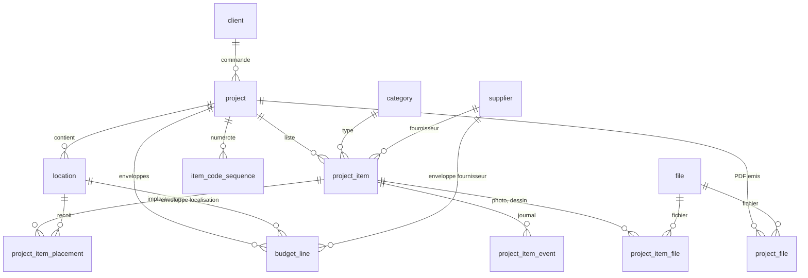

# Modèle de données v0 (recentré, ADR-0013)

> **Modèle recentré le 2026-10-12 (ADR-0013)** à partir de la liste de données de l'utilisateur (fiche de spec, listing FF&E, budget). Il remplace le modèle validé à l'étape 2 et enrichi jusqu'à l'étape 11 ; les modules devis, bons de commande, réceptions, factures et import de tarifs sont retirés du code (tag git `v0-complet`). Tant que la v1 n'est pas déclarée, le schéma se régénère depuis les modèles (ADR-0012) ; ce document fait foi pour les tables, les statuts, les formules et les accroches futures.

Cible : SQLite ≥ 3.37 (tables STRICT), un utilisateur, volumes faibles (centaines d'articles par projet). Accès par SQLAlchemy 2.0.x (`Mapped[]`), migration Alembic `0001_initial.py`, validation Pydantic v2 côté API. Aucune marge de revente ; plusieurs devises ; totaux et budgets en EUR HT.

---

## 1. Principe cardinal et vocabulaire

**Référentiel réutilisable** d'un côté, **instance projet** de l'autre.

| Terme | Définition | Tables |
|---|---|---|
| Référentiel | Données partagées entre projets, archivées plutôt que supprimées | `client`, `category` (types de produit), `professional` (annuaire), `supplier`, `product`, `file` |
| Instance projet | Ce qu'un projet fige : la fiche de l'article, son prix, sa devise, son taux, son fournisseur, son statut | `project`, `location`, `project_item`, `project_item_placement`, `project_item_event`, `project_item_file`, `budget_line`, `item_code_sequence`, `project_file` |
| Article (`project_item`) | **Une fiche de prescription** dans un projet : « Beat Light Fat, Flos, réf. BLS01, laiton, Ø 36 × H 30 cm, 1 062,50 GBP HT net ». Porte le code FF&E (`CHA-LUD-01`), le prix figé, le statut unique. Jamais l'emplacement |
| Implantation (`project_item_placement`) | **Un emplacement d'un article** : localisation + quantité par unité. La même lampe dans le lobby (×2) et en chambre typo A (×1, localisation ×12) = un article, deux implantations, quantité totale 14 (exemple suivi en §4.9, §4.10 et §6) |
| Localisation (`location`) | Lieu de destination dans un projet (lobby, bar, chambre typo A, suite…) avec sa **zone** (Zones communes, Hébergement, Back of house…), son **niveau** (R0, R+1…) et son **nombre** (multiplicateur, défaut 1) |
| Frais (`kind = 'fee'`) | Ligne forfaitaire par fournisseur (livraison, emballage…) : comptée dans le budget, sans type, sans implantation, absente des fiches |

Conséquences : pas de catalogue, l'article porte toute sa fiche (ADR-0016) ; un code identifie une fiche, pas une pièce ; les totaux sont calculés par `api/src/ffe/money.py`, jamais stockés ; zéro vue SQL ; le front n'additionne jamais.

---

## 2. Diagramme



---

## 3. Conventions transversales

| Sujet | Règle | Pourquoi / comment |
|---|---|---|
| Nommage | Tables au singulier, snake_case, anglais ; colonnes idem | Cohérent avec le code |
| Identifiants | `id INTEGER PRIMARY KEY` ; codes humains (`project.code`, `item_code`, `location.code`) séparés et éditables | Mono-utilisateur ; lisible |
| Horodatages | `created_at`, `updated_at` TEXT ISO-8601 UTC `2026-10-09T17:03:12Z`, posés par le service avec l'horloge injectée ; jamais `DEFAULT CURRENT_TIMESTAMP` | Tri lexicographique = chronologique ; testable |
| Dates métier | `*_on` TEXT `YYYY-MM-DD` + `CHECK GLOB` | Comparables |
| Argent | `*_cents INTEGER` HT `≥ 0` ; `currency` TEXT ISO 4217 `length = 3` | Pas de flottant |
| Taux | Points de base INTEGER `*_bp`, `BETWEEN 0 AND 10000` | Précision sans flottant |
| Quantités | Millièmes INTEGER `qty_milli` (1 000 = 1 ; 12 500 = 12,5) | Moquette et tringles existent |
| Taux de change | `fx_rate_micro INTEGER` : 1 unité de `currency` = `fx_rate_micro` / 1 000 000 EUR ; `1 000 000` imposé pour l'EUR ; saisi à la main, figé par article, réutilisé par défaut dans le projet | Entier ; aucun appel externe |
| Base de calcul | Totaux et budgets en **EUR** (`setting.base_currency`, `CHECK = 'EUR'`) ; conversion après remise, au prix unitaire net | Un seul référentiel |
| STRICT | Toutes les tables `STRICT` ; types `INTEGER`, `TEXT` seulement | Une insertion mal typée échoue |
| Booléens | `INTEGER NOT NULL DEFAULT 0 CHECK (x IN (0, 1))` | Pas de BOOLEAN en SQLite |
| Statuts et énumérations | `TEXT` + `CHECK (x IN (...))`, miroir d'un `Literal[...]` Pydantic ; pas de CHECK sur `project_item_event.kind` | Un seul endroit à changer ; le journal reste ouvert |
| UNIQUE métier | Jamais de colonne nullable dans un UNIQUE sans `COALESCE` ; index d'expression ou partiels écrits à la main dans la migration | Deux NULL sont distincts pour SQLite |
| FK | `foreign_keys = ON` ; `ON DELETE RESTRICT` partout sauf enfants stricts en `CASCADE` : `project_item_placement`, `project_item_event`, `project_item_file`, `item_code_sequence` ; toute FK a un index | Un référentiel utilisé ne disparaît jamais |
| FK composites | `UNIQUE (id, project_id)` sur `project_item` et `location` ; implantations et budgets référencent `(x_id, project_id)` | Aucune référence croisée entre projets |
| Archivage | `archived_at` sur `client`, `supplier`, `professional`, `category`, `location` ; `project` utilise `status` ; `project_item` le statut `cancelled` | On ne perd jamais une fiche vue par un client |
| Suppression physique bornée | `project_item` en `to_quote` sans autre événement que `created` ; `location` sans implantation ni budget ; `project_item_placement` (jamais la dernière) ; `budget_line` (par le `PUT` en bloc) ; jointures fichier | Règle d'app testée + RESTRICT en filet |
| Fichiers | `file` dédoublonné par `sha256`, stocké `FFE_DATA_DIR/files/<sha256>.<ext>` ; `unlink` seulement si plus aucune jointure (`project_item_file`, `project_file`) | Une seule logique |
| Nommage des contraintes | `naming_convention` SQLAlchemy (`pk_`, `fk_`, `uq_`, `ck_<table>_<nom>`, `ix_`) ; chaque CHECK nommé | Alembic batch exige des noms |
| Migrations | Avant la v1 : `0001_initial.py` unique régénérée (ADR-0012) ; après : additives, relues, jamais éditées | Règles maîtresses : ARCHITECTURE §5 |

---

## 4. Tables

Colonnes communes, non répétées : `id INTEGER PRIMARY KEY`, `created_at`, `updated_at` TEXT NOT NULL (sauf `project_item_event`, `item_code_sequence`, `project_file` ; `file` sans `updated_at`). `notes TEXT NULL` = texte libre interne. `TS` = horodatage, `DATE` = `YYYY-MM-DD`.

### 4.1 `setting` — ligne unique

| Colonne | Type | Null | Défaut | Contrainte | Commentaire |
|---|---|---|---|---|---|
| id | INTEGER | non | 1 | `CHECK (id = 1)` | insérée par la migration |
| base_currency | TEXT | non | `'EUR'` | `= 'EUR'` | |
| seed_category_version | INTEGER | non | 0 | | version du seed des types (`ffe db seed`) |
| project_code_prefix | TEXT | non | `''` | | `'P'` → `P2026-001` |
| agency_name, agency_address, agency_email, agency_phone | TEXT | name non, autres oui | `''` | | en-tête des PDF |

### 4.2 `client`

`name` (`length > 0`), `kind` (`individual` \| `company`), `contact_name`, `email`, `phone`, `address_line1`, `address_line2`, `postal_code`, `city`, `country_code` (2 lettres, `FR`), `siren` (9 chiffres ou NULL), `notes`, `archived_at`. Inchangée depuis l'étape 3.

### 4.3 `project`

| Colonne | Type | Null | Défaut | Contrainte | Commentaire |
|---|---|---|---|---|---|
| code | TEXT | non | — | `UNIQUE`, `length > 0` | `<préfixe>AAAA-NNN` généré, éditable |
| name | TEXT | non | — | `length > 0` | |
| client_id | INTEGER | non | — | FK `client` RESTRICT | |
| status | TEXT | non | `'prospect'` | `IN ('prospect','active','delivered','closed','cancelled')` | `closed`/`cancelled` = lecture seule |
| site_address | TEXT | oui | | | |
| due_on | DATE | oui | | format date | échéance |
| notes | TEXT | oui | | | |

### 4.4 `location` — localisation (ADR-0013)

| Colonne | Type | Null | Défaut | Contrainte | Commentaire |
|---|---|---|---|---|---|
| project_id | INTEGER | non | — | FK `project` RESTRICT ; `UNIQUE (id, project_id)` | |
| code | TEXT | non | — | `UNIQUE (project_id, code)` ; `length > 0` | `LOB`, `CHA`… premier segment du code FF&E |
| name | TEXT | non | — | `length > 0` | « Chambre typo A », « Lobby » |
| zone | TEXT | oui | | | « Zones communes », « Hébergement », « Back of house » ; texte libre avec suggestions ; axe de budget |
| level | TEXT | oui | | | « R0 », « R+1 » |
| multiplier | INTEGER | non | 1 | `>= 1` | nombre d'exemplaires (24 chambres) |
| sort_order | INTEGER | non | 0 | | |
| archived_at | TS | oui | | | |

### 4.5 `category` — type de produit

| Colonne | Type | Null | Défaut | Contrainte | Commentaire |
|---|---|---|---|---|---|
| code | TEXT | non | — | `UNIQUE` ; 2 à 4 majuscules | `AS`, `TAB`, `LUD`… segment central du code FF&E ; immuable |
| name | TEXT | non | — | `length > 0` ; `UNIQUE lower(name)` (index d'expression) | éditable |
| sort_order | INTEGER | non | 0 | | |
| archived_at | TS | oui | | | |

Un seul niveau. Seed (`ffe db seed`, 19 types) : AS Assise, TAB Table, TBR Tabouret, MOB Gros mobilier, LIT Lit, TAP Tapis, RID Rideau, LIN Linge, LUA Luminaire architectural, LUD Luminaire décoratif, MIR Miroir, DEC Décoration, ART Artwork, ACC Accessoire, ACA Accastillage, QUI Quincaillerie, SIG Signalétique, EQU Équipement, DIV Divers.

### 4.6 `professional` — annuaire

Fabricants (artisans et ateliers particuliers), distributeurs, éditeurs de tissu, artisans d'art : un carnet d'adresses, **jamais rattaché** à un produit ni à un article (ADR-0015). Chargé par `ffe db import-contacts <csv>`.

| Colonne | Type | Null | Défaut | Contrainte | Commentaire |
|---|---|---|---|---|---|
| name | TEXT | non | — | `length > 0` ; `UNIQUE lower(name)` | doublon détecté par nom normalisé (409 `duplicate`) |
| kind | TEXT | non | `'manufacturer'` | `IN ('manufacturer','distributor','publisher','artisan')` | prestation : Fabricant · Distributeur · Éditeur · Artisan |
| specialty | TEXT | oui | | | savoir-faire (Confection, Tapis, Luminaire sur-mesure…) |
| contact_name, phone, mobile, email | TEXT | oui | | | contact 1 |
| contact2_name, contact2_phone, contact2_email | TEXT | oui | | | contact 2 |
| website, notes | TEXT | oui | | | |
| archived_at | TS | oui | | | |

### 4.7 `supplier`

| Colonne | Type | Null | Défaut | Contrainte | Commentaire |
|---|---|---|---|---|---|
| name | TEXT | non | — | `length > 0` | doublon détecté par nom normalisé (409 `duplicate`) |
| specialty | TEXT | oui | | | savoir-faire (Mobilier, Luminaire, Sanitaire…) |
| contact_name, email, phone, mobile | TEXT | oui | | | représentant imprimé sur la fiche de spec (nom, e-mail, téléphone) |
| contact2_name, contact2_phone, contact2_email | TEXT | oui | | | second contact (back office…) |
| website | TEXT | oui | | | |
| currency | TEXT | non | `'EUR'` | `length = 3` | devise par défaut des articles ; masquée dans l'interface depuis le 2026-10-13 (toujours EUR à la création) |
| notes | TEXT | oui | | | |
| archived_at | TS | oui | | | |

### 4.8 (libre)

Le catalogue `product` / `product_file` a été retiré le 2026-10-13 (ADR-0016) : l'article porte sa fiche, « Coller une adresse » la pré-remplit.

### 4.9 `file` et jointure `project_item_file`

`file` : `sha256` (`UNIQUE`, 64), `ext`, `mime_type`, `size_bytes`, `original_name`, `source_url`, `license_note` (droit d'usage imprimé sous la photo), `created_at`. Jointure (`project_item_id`, `file_id` FK RESTRICT, `UNIQUE (parent_id, file_id)`) : `kind` (`image` \| `drawing` \| `other`), `is_primary` (une seule par parent, image seulement, index partiel), `caption`, `sort_order`. Suppression du parent en CASCADE.

### 4.10 `project_item` — l'article (pivot)

| Colonne | Type | Null | Défaut | Contrainte | Commentaire |
|---|---|---|---|---|---|
| project_id | INTEGER | non | — | FK `project` RESTRICT ; `UNIQUE (id, project_id)` | |
| item_code | TEXT | non | — | `UNIQUE (project_id, item_code)` ; `length > 0` | `<LOC>-<TYPE>-NN` (§7), éditable en `to_quote` |
| kind | TEXT | non | `'product'` | `IN ('product','fee')` | |
| category_id | INTEGER | oui | | FK `category` RESTRICT ; `(kind = 'fee') = (category_id IS NULL)` | type ; obligatoire pour un article |
| supplier_id | INTEGER | oui | | FK `supplier` RESTRICT | obligatoire pour `fee` (règle d'app) |
| name | TEXT | non | — | `length > 0` | désignation / nom produit |
| reference | TEXT | oui | | | référence produit |
| family | TEXT | oui | | `IN ('custom','joinery','ose','edition','gallery','artwork','textile')` | pièce sur-mesure, agencement, OS&E, pièce d'édition, pièce de galerie, artwork, confection |
| usage | TEXT | oui | | `IN ('indoor','outdoor')` | intérieur / extérieur |
| finish, dimensions, source_url, comments | TEXT | oui | | | la fiche de spec (dimensions en texte libre) |
| unit_cost_cents | INTEGER | non | 0 | `>= 0` | PU HT brut dans `currency` |
| currency | TEXT | non | `'EUR'` | `length = 3` | copiée du produit (s'il a un prix) sinon du fournisseur |
| fx_rate_micro | INTEGER | non | 1000000 | `> 0` ; `= 1000000` si EUR | figé par article |
| discount_bp | INTEGER | non | 0 | `BETWEEN 0 AND 10000` | saisie par article (plus de remise par défaut sur le fournisseur depuis le 2026-10-13) |
| quote_ref, quote_indice, quote_url | TEXT | oui | | | n° de devis, indice de devis (A, B…), lien vers le devis |
| status | TEXT | non | `'to_quote'` | `IN ('to_quote','quoted','to_review','approved','deposit','purchased','cancelled')` | §5 |
| indice | TEXT | oui | | | lettre de la diffusion des fiches où l'article a changé pour la dernière fois (§7) |
| sort_order | INTEGER | non | 0 | | |

Index : `(project_id, sort_order)`, `(project_id, status)`, `supplier_id`, `category_id`.

Création (`services/project_item.create_item`) : `category_id` et `name` requis pour un article ; `currency` : donnée, sinon celle du fournisseur, sinon EUR ; `fx_rate_micro` : donné, sinon le dernier taux du projet pour cette devise, sinon 422 ; `discount_bp` défaut 0 ; une implantation non affectée si `placements` absent.

Exemple : `(3, 'CHA-LUD-01', 'product', 10, 4, 9, 'Beat Light Fat', 'BLS01', 'edition', 'indoor', 'laiton', 'Ø 36 × H 30 cm', 'https://…', NULL, 125000, 'GBP', 1170000, 1500, 'DV-2026-118', 'A', NULL, 'approved', 'A', 0)`.

### 4.11 `project_item_placement` — implantation

| Colonne | Type | Null | Défaut | Contrainte | Commentaire |
|---|---|---|---|---|---|
| project_item_id, project_id | INTEGER | non | — | FK composite `project_item (id, project_id)` CASCADE | |
| location_id | INTEGER | oui | | FK composite `location (id, project_id)` RESTRICT | NULL = « non affecté » |
| qty_milli | INTEGER | non | 1000 | `>= 0` | par unité de localisation |
| sort_order | INTEGER | non | 0 | | |

`UNIQUE (project_item_id, COALESCE(location_id, 0))` (index d'expression). Un article `product` garde au moins une implantation ; un `fee` n'en a aucune.

### 4.12 `project_item_event` — journal

`project_item_id` FK CASCADE, `kind` (`created`, `status`, `price`, `placement`, `other`), `from_status`, `to_status`, `old_value`, `new_value` (JSON compact), `changed_at`, `note`. Écrit dans la transaction de chaque changement de statut, de prix (coût, remise, devise, taux), de produit ou d'implantation.

### 4.13 `item_code_sequence`

PK `(project_id, location_code, prefix)`, `next_value ≥ 1`, FK `project` CASCADE. `location_code = ''` sans localisation. Jamais décrémentée.

### 4.14 `budget_line` — prévisionnel

| Colonne | Type | Null | Défaut | Contrainte | Commentaire |
|---|---|---|---|---|---|
| project_id | INTEGER | non | — | FK `project` RESTRICT | |
| scope | TEXT | non | — | `IN ('global','location','zone','family','supplier')` | |
| location_id | INTEGER | oui | | FK composite `location (id, project_id)` RESTRICT ; `(scope = 'location') = (location_id IS NOT NULL)` | |
| zone | TEXT | oui | | `(scope = 'zone') = (zone IS NOT NULL)` | valeur de `location.zone` |
| family | TEXT | oui | | `(scope = 'family') = (family IS NOT NULL)` | valeur de `project_item.family` |
| supplier_id | INTEGER | oui | | FK `supplier` RESTRICT ; `(scope = 'supplier') = (supplier_id IS NOT NULL)` | |
| amount_cents | INTEGER | non | — | `>= 0` | EUR HT |
| notes | TEXT | oui | | | |

`UNIQUE (project_id, scope, COALESCE(location_id, 0), COALESCE(zone, ''), COALESCE(family, ''), COALESCE(supplier_id, 0))`. Remplacement en bloc par `PUT`.

### 4.15 `project_file` — PDF émis

`project_id` FK RESTRICT, `file_id` FK RESTRICT, `kind` (`sheets_pdf` \| `list_pdf`), `issued_at`, `indice` (lettre des fiches). Chaque émission est conservée telle qu'envoyée.

---

## 5. Statut unique (ADR-0013)

`STATUS_RANK` (`money.py`) : `to_quote` 0 · `quoted` 1 · `to_review` 1 · `approved` 2 · `deposit` 3 · `purchased` 4 · `cancelled` −1. Libellés : À chiffrer · Devisé · À revoir · Validé · Acompte · Acheté · Annulé.

- Changement **libre** entre les sept valeurs (`POST /project-items/{id}/status`), même statut → 409 ; note facultative ; événement `status` à chaque fois.
- `is_counted = status <> 'cancelled'` ; **Prescrit** = Σ des articles comptés ; **Devisé** = ceux de rang ≥ 1 ; **Validé** = rang ≥ 2. Un `fee` compte dans les trois selon son statut.
- Suppression physique : `to_quote` sans autre événement que `created` ; sinon annuler.
- Projet `closed`/`cancelled` : toute écriture sur ses localisations et articles est refusée (409).

---

## 6. Formules de calcul (`api/src/ffe/money.py`)

Arithmétique entière, arrondi au centime **demi-supérieur** : `div_round(n, d) = (n + d // 2) // d` pour `n ≥ 0`.

```
total_qty_milli    = Σ implantations (qty_milli × location.multiplier)      # fee : 1 000 × 1
net_unit_cents     = div_round(unit_cost_cents × (10000 − discount_bp), 10000)   # devise de l'article
net_unit_eur_cents = div_round(net_unit_cents × fx_rate_micro, 1_000_000)
total_ht_cents     = div_round(net_unit_eur_cents × total_qty_milli, 1000)
placement_ht_cents = div_round(net_unit_eur_cents × qty_milli × multiplier, 1000)  # part d'une implantation
share_bp           = div_round(part × 10000, whole)                                 # parts par état
alerte             = none < 90 % ≤ warning < 100 % ≤ over du budget du périmètre
```

Ordre fixé : remise, puis change, puis quantité. Les totaux **par article** sont la référence ; les totaux par localisation ou zone somment les parts d'implantation et peuvent différer d'un centime.

**Exemple** (article §4.10, implantations LOB ×2 et CHA ×1 avec CHA ×12) : net 106 250 GBP → 124 313 € (124 312,5 arrondi) → total 14 × 1 243,13 = 17 403,82 € ; parts : LOB 2 486,26 €, CHA 14 917,56 €.

**Synthèse** (`services/budget.summary`, `GET /projects/{id}/summary`) : par article (`lines`), totaux Prescrit / Devisé / Validé, reste et alerte sur le budget global ; `by_status` (nombre, montant, part en bp) ; compilations `by_location`, `by_zone`, `by_family`, `by_type`, `by_supplier` (budget du périmètre, prescrit, devisé, validé, reste, alerte) ; filtres `locationId`, `zone`, `family`, `categoryId`, `supplierId` (une localisation ou une zone restreint aux implantations qui y sont ; les frais n'ont pas de lieu).

---

## 7. Codes FF&E, séquences, indices

- Code : `<LOC>-<TYPE>-NN` — code de la localisation de la première implantation (vide → `<TYPE>-NN`), code du type, numéro à 2 chiffres minimum par (projet, localisation, type) ; frais : `FR-NN`. Attribution par `INSERT … ON CONFLICT … RETURNING` sur `item_code_sequence`, jamais décrémentée. Éditable en `to_quote` (unique par projet) ; changer le type d'un article `to_quote` lui donne un nouveau code ; déplacer l'article ne le renumérote pas.
- Codes projet : `<project_code_prefix><AAAA>-NNN` par `MAX + 1` sur l'année ; éditables.
- Indice de diffusion : chaque émission des fiches (`sheets_pdf`) porte une lettre = rang de l'émission ; tout article jamais émis ou modifié (`updated_at`) depuis l'émission précédente prend cette lettre dans `project_item.indice`. Le listing ne pose rien.

---

## 8. Accroches pour plus tard (ajouts additifs seulement)

| Besoin | Ajout le jour venu |
|---|---|
| Devis, bons de commande, réceptions, factures (retirés par ADR-0013, code sous le tag `v0-complet`) | tables `quote*`, `purchase_order*`, `delivery*`, `supplier_invoice` à reprendre avec le statut unique (`deposit`, `purchased`) ; `engaged`, `invoiced`, `paid` dans la synthèse |
| Import de tarifs xlsx/CSV (retiré) | `import_batch`, `price_observation`, `supplier.import_mapping` ; openpyxl |
| Exports xlsx (listing, budget) | `project_file.kind` + `'list_xlsx'`, `'budget_xlsx'` ; openpyxl, valeurs seulement |
| Marge / prix de vente | `project_item.markup_bp`, `unit_sell_override_cents`, `setting.pricing_mode` |
| Options A/B, remplacement tracé | `project_item.alternative_of_id`, `replaced_by_id` (FK composites) |
| Délai et date de besoin | `project_item.lead_time_weeks`, `required_on_site` ; alerte « commander avant le » |
| TVA et TTC | `project.default_vat_bp`, `project_item.vat_rate_bp` ; `vat_totals` dans `money.py` |
| Identité légale des fournisseurs, recherche d'entreprises (F3) | `supplier.siren/siret/vat_number/adresse`, `supplier_registry_snapshot` ; jamais de dirigeant |
| Capture produit (F5–F6) | `product_source`, `capture_inbox`, `setting.api_token` |
| Multi-utilisateur, bureau | `app_user`, colonnes `*_by`, `public_id` |
| Autres devises de base | lever `CHECK (base_currency = 'EUR')` |
