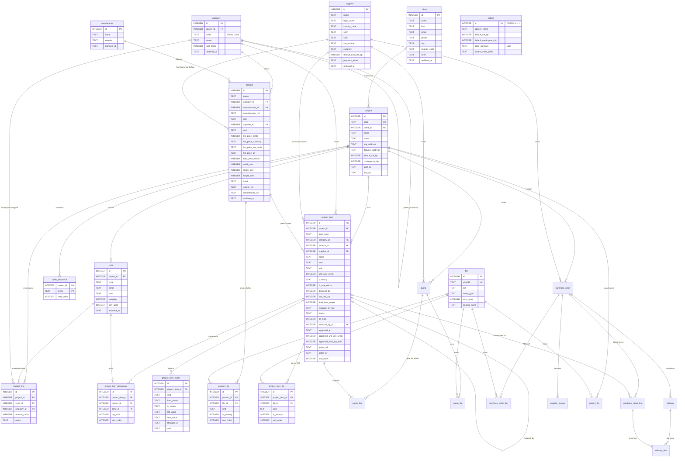

# Modèle de données v1

> **Modèle validé à l'étape 2 (2026-10-09)** : décisions D2.1 à D2.15 (JOURNAL), rejeu des 12 cas en §10. Toute migration s'écrit à partir de ce document ; un changement de fond passe par une ADR.
> Rédigé le 2026-10-09. Fait foi : le cadrage du 2026-10-09 (JOURNAL D0.1 à D0.8), ADR-0003 (argent, dates, identifiants) et ADR-0005 (lignes, placements, prix). Les seuls points encore ouverts sont marqués « à trancher à l'étape N » et concernent des valeurs, jamais la structure.

Cible : SQLite ≥ 3.37 (tables STRICT), un utilisateur, volumes faibles (centaines de lignes par projet). Accès par SQLAlchemy 2.0.x (`Mapped[]`), migrations Alembic en mode batch, validation Pydantic v2 côté API. Aucune marge de revente en v1 ; plusieurs devises dès la v1 ; totaux et budgets en EUR.

---

## 1. Principe cardinal et vocabulaire

**Référentiel réutilisable** d'un côté, **instance projet** de l'autre.

| Terme | Définition | Tables |
|---|---|---|
| Référentiel | Données partagées entre projets, à durée de vie longue, archivées plutôt que supprimées | `client`, `category`, `manufacturer`, `supplier`, `product`, `file` |
| Instance projet | Ce qu'un projet fige : spécification, prix, devise, taux de change, fournisseur, délai, statut | `project`, `zone`, `project_item`, `project_item_placement`, `project_item_event`, `project_item_file`, `budget_line`, `code_sequence` |
| Ligne (`project_item`) | **Une spécification** dans un projet : « suspension Tom Dixon Beat Light Fat, laiton, 1 062,50 GBP HT net ». Porte le repère (`LUM-003`), le prix figé, le statut. Jamais la localisation |
| Placement (`project_item_placement`) | **Un emplacement d'une ligne** : zone + quantité par zone. La même suspension dans le lobby (×2) et dans la chambre type A (×1, zone ×12) = une ligne, deux placements, quantité totale 14 (exemple suivi en §4.11, §4.12 et §6) |
| Zone | Lieu de destination d'un projet, avec un **multiplicateur** (défaut 1 ; 12 pour « Chambre type A ×12 ») |
| Produit | Fiche catalogue réutilisable ; la ligne en **copie** ce dont elle a besoin à l'association, puis vit sa vie |
| Snapshot | Valeur copiée à un instant et jamais recalculée depuis la source : prix figé sur la ligne, `approved_*` à la validation client |

Conséquences : le catalogue peut changer sans réécrire l'historique d'un projet ; un repère identifie une spécification, pas une pièce ; une commande fournisseur future = une ligne, quantité totale.

Rien de calculé n'est stocké. Tous les montants dérivés (net, EUR, totaux, TVA) sortent de `api/src/ffe/money.py` ; zéro vue SQL ; le front n'additionne jamais.

---

## 2. Diagramme



Diagramme réduit aux colonnes structurantes ; les tables §4 font foi. Rendu à vérifier dans l'aperçu Markdown de VS Code avant commit.

---

## 3. Conventions transversales

| Sujet | Règle v1 | Pourquoi / comment |
|---|---|---|
| Nommage | Tables au singulier, snake_case, anglais. Colonnes idem. Jamais `user` (futur `app_user`) | Cohérent avec le code ; évite un renommage |
| Identifiants | `id INTEGER PRIMARY KEY` (alias du rowid, sans `AUTOINCREMENT`). Codes humains (`project.code`, `item_code`, `zone.code`) séparés et éditables | Mono-utilisateur ; lisible ; la réutilisation d'un rowid après suppression est sans effet métier car les enfants sont en CASCADE ou RESTRICT |
| Horodatages | `created_at`, `updated_at` TEXT ISO-8601 UTC `2026-10-09T17:03:12Z`, posés par le service avec l'horloge injectée (ARCHITECTURE §3) ; pas de `default`/`onupdate` ORM. **Aucun `DEFAULT CURRENT_TIMESTAMP`** (format SQLite sans `T` ni `Z`) | Tri lexicographique = chronologique ; un seul format ; testable avec une horloge fixe |
| Dates métier | Colonnes `*_on` TEXT `YYYY-MM-DD` ; `CHECK (x IS NULL OR x GLOB '[0-9][0-9][0-9][0-9]-[0-9][0-9]-[0-9][0-9]')` | Comparables par `<`, `>`, `date()` |
| Argent | `*_cents INTEGER` HT, `CHECK (>= 0)` ; devise ISO 4217 dans une colonne `currency` TEXT `CHECK (length(currency) = 3)` à côté | Pas de flottant ; sommes exactes |
| Taux | Points de base INTEGER (`*_bp`, 10 000 = 100 %) ; `CHECK (BETWEEN 0 AND 10000)` pour remises et TVA | Précision d'un DECIMAL(5,2) sans flottant |
| Quantités | Millièmes INTEGER (`qty_milli`, 1 000 = 1 ; 12 500 = 12,5 m²). Unités à la pièce : `qty_milli % 1000 = 0` (règle d'app) | Moquette et tringles existent ; changer la sémantique plus tard toucherait `money.py` et les exports |
| Taux de change | `fx_rate_micro INTEGER` : 1 unité de `currency` = `fx_rate_micro` / 1 000 000 EUR. `1 000 000` pour l'EUR, imposé par CHECK. Saisi à la main, figé par ligne | Entier ; six décimales suffisent (1 GBP = 1,170000 EUR) ; aucun appel externe |
| Base de calcul | Totaux, TVA et budgets en **EUR** (`setting.base_currency`, `CHECK = 'EUR'` en v1). Conversion après remise, au niveau du prix unitaire net | Un seul référentiel pour comparer budget et prescrit |
| STRICT | Toutes les tables `STRICT` : types déclarés parmi `INTEGER`, `TEXT`, `REAL`, `BLOB` ; une insertion mal typée échoue | Rend `CHECK (typeof(x) = 'integer')` inutile. Ce CHECK reste la solution de repli documentée si une table devait un jour ne pas être STRICT |
| Booléens | `INTEGER NOT NULL DEFAULT 0 CHECK (x IN (0, 1))` | Pas de type BOOLEAN en SQLite |
| Statuts et énumérations | `TEXT` + `CHECK (x IN (...))`, miroir exact d'un `Literal[...]` Pydantic (test d'égalité). Pas de CHECK sur `project_item_event.kind` | Un seul endroit à changer + une migration ; le journal reste ouvert |
| UNIQUE métier | Jamais de colonne nullable dans un UNIQUE sans `COALESCE` (SQLite considère deux NULL distincts). Index d'expression `UNIQUE (a, COALESCE(b, 0))` ; index partiels `WHERE x IS NOT NULL` | Doublon = toujours une erreur là où la contrainte est dure ; ailleurs index non unique + avertissement UI (409 typé) |
| FK | `foreign_keys = ON` à chaque connexion ; `ON DELETE RESTRICT` partout sauf **enfants stricts** en `CASCADE` : `project_item_placement`, `project_item_event`, `project_item_file`, `product_file`, `code_sequence`. Toute FK a un index (SQLite n'en crée pas) | Un référentiel utilisé ne disparaît jamais ; un enfant sans parent n'a pas de sens |
| FK composites | `UNIQUE (id, project_id)` sur `project_item` et `zone` ; placements, budgets et `replaced_by_id` référencent `(x_id, project_id)` | Aucune référence croisée entre projets, même par bug d'UI |
| Archivage | `archived_at` TEXT NULL sur `client`, `supplier`, `manufacturer`, `category`, `product`, `zone`. Archivé = masqué des sélecteurs, jamais des données existantes. `project` utilise `status` ; `project_item` un statut terminal | On ne perd jamais une ligne vue par un client |
| Suppression physique bornée | Autorisée seulement pour : `project_item` en `draft` sans événement autre que sa création, `zone` sans placement ni budget, `project_item_placement`, `budget_line`, jointures fichier. Le reste : RESTRICT ou archivage | Règle d'app testée + RESTRICT en filet |
| Fichiers | `file` dédoublonné par `sha256`, stocké `FFE_DATA_DIR/files/<sha256>.<ext>` ; `unlink` seulement si plus aucune jointure (`product_file`, `project_item_file`) ne le référence ; `ffe db check` compare disque et base dans les deux sens | Une seule logique de stockage |
| Nommage des contraintes | `naming_convention` SQLAlchemy sur le `MetaData` : `pk_%(table_name)s`, `fk_%(table_name)s_%(column_0_name)s_%(referred_table_name)s`, `uq_%(table_name)s_%(column_0_name)s`, `ck_%(table_name)s_%(constraint_name)s`, `ix_%(table_name)s_%(column_0_name)s`. Les CHECK reçoivent un nom explicite (`name=`) | Alembic batch (`render_as_batch=True`) ne peut supprimer ou modifier qu'une contrainte nommée ; SQLite n'a pas d'`ALTER CONSTRAINT` |
| Migrations | Une par étape ; brouillon `--autogenerate` relu ligne à ligne, index d'expression ou partiels et STRICT ajoutés à la main et déclarés dans les métadonnées ; `alembic check` en test ; sauvegarde avant `upgrade` | Règles maîtresses : ARCHITECTURE §5 |
| Validation | Pydantic v2 valide longueurs, formats, règles inter-champs ; les CHECK sont le filet exact de dernier recours | SQLite ignore les longueurs de TEXT |

Vérifié à l'étape 3 (D3.7) : `sqlite_strict=True` émet bien `STRICT` (SQLAlchemy 2.0.54), mais le mode batch d'Alembic l'ignore lors d'une recréation ; règle et filet de test : ARCHITECTURE §5 (maître).

---

## 4. Tables

Colonnes communes, non répétées : `id INTEGER PRIMARY KEY`, `created_at TEXT NOT NULL`, `updated_at TEXT NOT NULL` (sauf `project_item_event` et `code_sequence` ; `file` sans `updated_at`). `notes TEXT NULL` = texte libre interne sur les référentiels. Types notés tels qu'écrits dans le DDL STRICT. `TS` = TEXT horodatage, `DATE` = TEXT `YYYY-MM-DD`.

### 4.1 `setting` — étape 3, complétée par `ADD COLUMN` aux étapes 6a, 6c, 8 et 9 (D2.8)

Réglages de l'installation, une seule ligne. Identité de l'agence pour les futurs exports, défauts hérités par les projets, devise de base. La migration 0001 ne crée que les colonnes utilisées aux étapes 3–4 ; chaque autre colonne arrive, additive, à l'étape indiquée.

| Colonne | Étape | Type | Null | Défaut | Contrainte | Commentaire |
|---|---|---|---|---|---|---|
| id | 3 | INTEGER | non | — | PK, `CHECK (id = 1)` | une ligne, insérée par la migration 0001 |
| default_vat_bp | 3 | INTEGER | non | `2000` | `BETWEEN 0 AND 10000` | hérité par `project.default_vat_bp` |
| base_currency | 3 | TEXT | non | `'EUR'` | `CHECK (base_currency = 'EUR')` | lever le CHECK = migration future |
| seed_category_version | 6a | INTEGER | non | `0` | `>= 0` | version du seed appliqué |
| project_code_prefix | 6c | TEXT | non | `''` | | `'P'` donne `P2026-001` |
| default_contingency_bp | 8 | INTEGER | non | `1000` | `BETWEEN 0 AND 10000` | hérité par `project.contingency_bp` ; 10 % confirmé par défaut à l'étape 8 (D8.2) |
| agency_name | 9 | TEXT | non | `''` | | en-tête des exports |
| agency_address | 9 | TEXT | oui | | | multiligne |
| agency_email, agency_phone | 9 | TEXT | oui | | | |
| agency_siret | 9 | TEXT | oui | | `GLOB` 14 chiffres | |
| agency_vat_number | 9 | TEXT | oui | | | `FR12345678901`, sans espaces |

Exemple (état final) : `(1, 2000, 'EUR', 1, '', 1000, 'Atelier X', '12 rue …', 'contact@…', NULL, '12345678900012', 'FR12345678900')`.

### 4.2 `client` — étape 3

Donneur d'ordre d'un ou plusieurs projets ; en-tête des exports. Gabarit de toutes les ressources (API étape 4, front étape 5).

| Colonne | Type | Null | Défaut | Contrainte | Commentaire |
|---|---|---|---|---|---|
| name | TEXT | non | — | `length(name) > 0` | « M. et Mme X » ou société |
| kind | TEXT | non | `'individual'` | `IN ('individual','company')` | |
| contact_name, email, phone | TEXT | oui | | | |
| address_line1, address_line2, postal_code, city | TEXT | oui | | | adresse structurée |
| country_code | TEXT | non | `'FR'` | `length(country_code) = 2` | ISO 3166-1 alpha-2 |
| siren | TEXT | oui | | `siren IS NULL OR siren GLOB '[0-9][0-9][0-9][0-9][0-9][0-9][0-9][0-9][0-9]'` | 9 chiffres exactement |
| notes | TEXT | oui | | | |
| archived_at | TS | oui | | | |

Index : `(archived_at, name)`. Pas d'UNIQUE sur `name` (homonymes réels) : le service détecte le doublon insensible à la casse et aux accents (NFD + minuscules) et répond 409 `conflict` avec `archivedId` si le doublon est archivé ; sinon 409 `code: "duplicate"` avec `existingId`, sauf si la requête porte `?force=true` (création acceptée). Même règle pour `supplier.name` (API.md §Format d'erreur).

Exemple : `('Famille Martin', 'individual', NULL, 'martin@…', NULL, '4 rue des Lilas', NULL, '75011', 'Paris', 'FR', NULL, NULL, NULL)`.

### 4.3 `project` — étape 6c

Conteneur de tout le travail ; porte les défauts hérités par les lignes à leur création et les adresses des futurs bons de commande. Pas de devise : chaque ligne porte la sienne, les totaux sont en EUR.

| Colonne | Type | Null | Défaut | Contrainte | Commentaire |
|---|---|---|---|---|---|
| code | TEXT | non | — | `UNIQUE`, `length(code) > 0` | auto `2026-001` (préfixe `setting.project_code_prefix` + année + `MAX + 1`), éditable |
| name | TEXT | non | — | | |
| client_id | INTEGER | non | — | FK `client` RESTRICT | |
| status | TEXT | non | `'prospect'` | `IN ('prospect','active','delivered','closed','cancelled')` | |
| site_address | TEXT | oui | | | chantier (≠ adresse client) |
| delivery_address, delivery_contact | TEXT | oui | | | livraison si ≠ chantier ; NULL = chantier |
| default_vat_bp | INTEGER | non | `setting` | `BETWEEN 0 AND 10000` | copié de `setting` à la création, hérité par les lignes |
| contingency_bp | INTEGER | non | `0` | `BETWEEN 0 AND 10000` | **étape 8** (`ADD COLUMN`, migration 0006, D2.6) ; la migration recopie `setting.default_contingency_bp` sur les projets existants ; ensuite copié de `setting` à la création ; appliqué au budget global |
| start_on, due_on | DATE | oui | | `due_on IS NULL OR start_on IS NULL OR due_on >= start_on` | |
| notes | TEXT | oui | | | |

Index : `(client_id)`, `(status)`. Pas d'`archived_at` ni de suppression physique : `closed`/`cancelled` jouent le rôle de l'archivage (aucun `DELETE /projects/{id}`, API.md). Étape 6c (testé) : un projet `closed`/`cancelled` est en lecture seule (projet et zones, 409) tant que son statut n'est pas changé ; un client avec un projet non clos ne s'archive pas (409) ; `code` généré par `MAX + 1` sur l'année sous `UNIQUE (code)`, préfixe `setting.project_code_prefix` ; `default_vat_bp` copié de `setting` à la création.

Exemple : `('2026-003', 'Hôtel X — rénovation étages', 7, 'active', '1 place …, Lyon', NULL, NULL, 2000, 1000, '2026-11-01', '2027-06-30', NULL)`.

### 4.4 `zone` — étape 6c

Lieu de destination d'un projet. Porte le **multiplicateur** : quantité réelle d'un placement = `qty_milli × multiplier`. Liste plate (hiérarchie : accroche §9).

| Colonne | Type | Null | Défaut | Contrainte | Commentaire |
|---|---|---|---|---|---|
| project_id | INTEGER | non | — | FK `project` RESTRICT | |
| code | TEXT | non | — | `UNIQUE (project_id, code)` | court, pour les plans : `LOB`, `CHA` |
| name | TEXT | non | — | | « Lobby », « Chambre type A » |
| kind | TEXT | oui | | | type libre (« chambre », « sdb ») pour regroupements |
| multiplier | INTEGER | non | `1` | `multiplier >= 1` | 12 pour douze chambres identiques |
| sort_order | INTEGER | non | `0` | | ordre du book et du schedule |
| notes | TEXT | oui | | | |
| archived_at | TS | oui | | | zone sortie du périmètre |

Contrainte technique : `UNIQUE (id, project_id)` (cible des FK composites). Index : `(project_id, sort_order)`. Invariants d'app : modifier `multiplier` quand des lignes placées sont `approved` ou plus exige confirmation et écrit un événement `qty` sur chaque ligne touchée, sans exiger de nouvelle validation client (D2.3 ; l'écart apparaît dans R9) ; archiver une zone exige que ses placements soient sur des lignes `cancelled`/`replaced` ou soient déplacés ; suppression physique seulement sans placement ni budget (RESTRICT en filet).

Exemple : `(3, 'CHA', 'Chambre type A', 'chambre', 12, 20, NULL, NULL)`.

### 4.5 `category` — étape 6a

Arbre à 2 niveaux (Assises > Fauteuil). Le code du niveau 1 est le préfixe des codes articles ; la catégorie est aussi l'axe du budget. Seed de 13 codes (défaut) : AS, TAB, RAN, LIT, LUM, TXT, DEC, CUI, SAN, MEN, EQU, FRA, DIV ; éditable.

| Colonne | Type | Null | Défaut | Contrainte | Commentaire |
|---|---|---|---|---|---|
| parent_id | INTEGER | oui | | FK `category` RESTRICT | NULL = niveau 1 ; profondeur 2 = règle d'app testée |
| code | TEXT | oui | | `(parent_id IS NULL) = (code IS NOT NULL)` ; `code IS NULL OR (code NOT GLOB '*[^A-Z]*' AND length(code) BETWEEN 2 AND 4)` | niveau 1 seul ; 2–4 majuscules ASCII |
| name | TEXT | non | — | index unique d'expression `(COALESCE(parent_id, 0), name)` | |
| sort_order | INTEGER | non | `0` | | |
| archived_at | TS | oui | | | `DIV` jamais archivable (règle d'app) |

Index unique partiel `(code) WHERE code IS NOT NULL`. Index `(parent_id, sort_order)`.

Règles d'app (étape 6a, D6a.2 et D6a.9, testées) : profondeur 2 (un enfant n'a pas d'enfant) ; `code` fixé à la création d'un niveau 1 et immuable ensuite ; `parent_id` immuable (les codes articles en dépendent) ; nom unique sous un même parent, comparé normalisé par le service avant l'index ; archiver un niveau 1 exige ses enfants archivés ; désarchiver un enfant exige un parent actif ; `DIV` jamais archivable. Seed : `ffe db seed` (`db/seed.py`), `INSERT … ON CONFLICT (code) WHERE code IS NOT NULL DO NOTHING`, pose `setting.seed_category_version`.

Exemple : `(NULL, 'LUM', 'Luminaires', 50, NULL)` puis `(5, NULL, 'Applique', 20, NULL)`.

### 4.6 `manufacturer` — étape 6a

Marque / fabricant du produit (Vitra, Flos), distinct du fournisseur qui vend et facture.

| Colonne | Type | Null | Défaut | Contrainte | Commentaire |
|---|---|---|---|---|---|
| name | TEXT | non | — | index unique d'expression `(lower(name))` | `lower()` SQLite est ASCII : le service normalise (trim, accents) avant insertion |
| website | TEXT | oui | | | |
| notes | TEXT | oui | | | |
| archived_at | TS | oui | | | |

Exemple : `('Flos', 'https://flos.com', NULL, NULL)`.

### 4.7 `supplier` — étape 6a

Qui vend et facture ; en-tête des futurs BC ; cible de la future recherche d'entreprises (seul `name` requis ; aucun dirigeant stocké, jamais).

| Colonne | Type | Null | Défaut | Contrainte | Commentaire |
|---|---|---|---|---|---|
| name | TEXT | non | — | `length(name) > 0` | nom d'usage |
| legal_name | TEXT | oui | | | raison sociale |
| country_code | TEXT | non | `'FR'` | `length = 2` | |
| siren | TEXT | oui | | `GLOB` 9 chiffres | pas d'unicité (showroom + dépôt facturant) ; index non unique + avertissement |
| siret | TEXT | oui | | `siret IS NULL OR (siret GLOB '[0-9]…×14' AND (siren IS NULL OR substr(siret, 1, 9) = siren))` | index unique partiel `WHERE siret IS NOT NULL` |
| vat_number | TEXT | oui | | | sans espaces |
| address_line1, address_line2, postal_code, city | TEXT | oui | | | |
| contact_name, email, phone, website | TEXT | oui | | | jamais fournis par un registre |
| currency | TEXT | non | `'EUR'` | `length(currency) = 3` | devise de facturation, copiée sur la ligne à l'affectation |
| default_discount_bp | INTEGER | non | `0` | `BETWEEN 0 AND 10000` | remise pro habituelle, copiée sur la ligne |
| payment_terms | TEXT | oui | | | « 30 % à la commande, solde avant livraison » |
| notes | TEXT | oui | | | |
| archived_at | TS | oui | | | |

Index : `(archived_at, name)`, `(siren)`, unique partiel `(siret)`.

Exemple : `('Tom Dixon Ltd', 'Tom Dixon Limited', 'GB', NULL, NULL, 'GB123456789', …, 'GBP', 1500, 'Prépaiement', NULL, NULL)`.

### 4.8 `product` — étape 6b

Fiche catalogue réutilisable : identité, dimensions, prix catalogue observé. Un produit → N lignes dans N projets ; le prix d'un projet ne dépend pas de cette table.

| Colonne | Type | Null | Défaut | Contrainte | Commentaire |
|---|---|---|---|---|---|
| name | TEXT | non | — | | |
| description | TEXT | oui | | | |
| category_id | INTEGER | non | — | FK `category` RESTRICT | `DIV` pour ne jamais bloquer |
| manufacturer_id | INTEGER | oui | | FK `manufacturer` RESTRICT | |
| manufacturer_ref | TEXT | oui | | index non unique `(manufacturer_id, manufacturer_ref)` | une ref couvre souvent plusieurs finitions ; avertissement UI |
| gtin | TEXT | oui | | `gtin IS NULL OR gtin NOT GLOB '*[^0-9]*'` | EAN/GTIN ; index non unique |
| supplier_id | INTEGER | oui | | FK `supplier` RESTRICT | fournisseur par défaut |
| supplier_ref | TEXT | oui | | | |
| unit | TEXT | non | `'piece'` | `IN ('piece','pair','set','lot','m','m2','roll')` | |
| list_price_cents | INTEGER | oui | | `>= 0` | NULL = inconnu |
| list_price_currency | TEXT | non | `'EUR'` | `length = 3` | devise du prix catalogue |
| list_price_tax_mode | TEXT | non | `'ht'` | `IN ('ht','ttc')` | un prix public web est TTC |
| list_price_vat_bp | INTEGER | oui | | `list_price_tax_mode = 'ht' OR list_price_vat_bp IS NOT NULL` ; `BETWEEN 0 AND 10000` | nécessaire pour ramener un TTC en HT |
| list_price_on | DATE | oui | | format date | date d'observation |
| lead_time_weeks | INTEGER | oui | | `>= 0` | délai habituel |
| width_mm, depth_mm, height_mm, diameter_mm | INTEGER | oui | | `>= 0` | |
| materials, finish, color | TEXT | oui | | | défauts copiés sur la ligne |
| source_url | TEXT | oui | | | |
| source_kind | TEXT | non | `'manual'` | aucun CHECK | Pydantic : `manual`, `url` ; `clipper` plus tard |
| discontinued_on | DATE | oui | | format date | |
| notes | TEXT | oui | | | |
| archived_at | TS | oui | | | |

Index : `(category_id)`, `(manufacturer_id)`, `(supplier_id)`, `(archived_at, name)`, `(gtin)`. Sur mesure / existant = `project_item.kind`, pas une propriété du produit.

Exemple : `('Beat Light Fat', NULL, 22, 4, 'BLS03', NULL, 9, NULL, 'piece', 125000, 'GBP', 'ht', NULL, '2026-09-15', 8, NULL, NULL, 360, 240, NULL, 'laiton', 'noir', 'https://…', 'manual', NULL, NULL, NULL)`.

### 4.9 `file` — étape 6b

Fichier physique dédoublonné. Les propriétaires passent par `product_file` et `project_item_file`.

| Colonne | Type | Null | Défaut | Contrainte | Commentaire |
|---|---|---|---|---|---|
| sha256 | TEXT | non | — | `UNIQUE`, `length(sha256) = 64` | hexadécimal minuscule |
| ext | TEXT | non | — | `length(ext) BETWEEN 1 AND 10` | sans point : `pdf`, `jpg` |
| mime_type | TEXT | non | — | | |
| size_bytes | INTEGER | non | — | `size_bytes >= 0` | limite 20 Mo côté API (défaut étape 6b) |
| original_name | TEXT | non | — | | |
| source_url | TEXT | oui | | | provenance d'une image |

Chemin : `FFE_DATA_DIR/files/<sha256>.<ext>` ; vignette `<sha256>.thumb.jpg` par convention, régénérable, pas de colonne. Pas d'`updated_at` : un fichier est immuable.

### 4.10 `product_file` — étape 6b

Jointure produit ↔ fichier : photos, fiches techniques, dessins.

| Colonne | Type | Null | Défaut | Contrainte | Commentaire |
|---|---|---|---|---|---|
| product_id | INTEGER | non | — | FK `product` **CASCADE** | |
| file_id | INTEGER | non | — | FK `file` RESTRICT ; `UNIQUE (product_id, file_id)` | |
| kind | TEXT | non | `'image'` | `IN ('image','datasheet','drawing','other')` | |
| is_primary | INTEGER | non | `0` | `IN (0, 1)` ; `is_primary = 0 OR kind = 'image'` | index unique partiel `(product_id) WHERE is_primary = 1` |
| caption | TEXT | oui | | | |
| sort_order | INTEGER | non | `0` | | |

Index : `(file_id)`. Après suppression d'une jointure, `unlink` du fichier seulement si `SELECT count(*)` sur les deux tables de jointure vaut 0, puis `DELETE FROM file`.

Étape 6b (D6b.5–D6b.11, testé) : extension et MIME déduits de la signature des octets (JPEG, PNG, WebP, PDF), jamais du nom client ; même sha256 → une seule ligne et un seul fichier ; `is_primary` posé retire l'ancienne principale (`flush` avant l'insertion pour l'index partiel) ; `PATCH …/files/{fileId}` modifie `kind`, `is_primary`, `caption`, `sort_order`.

### 4.11 `project_item` — étape 7a (pivot)

Une spécification dans un projet : quoi, en quelle finition, à quel prix figé dans quelle devise, à quel stade. Tolère les brouillons. Tout export lit cette table.

| Colonne | Type | Null | Défaut | Contrainte | Commentaire |
|---|---|---|---|---|---|
| project_id | INTEGER | non | — | FK `project` RESTRICT ; `UNIQUE (id, project_id)` | |
| item_code | TEXT | non | — | `UNIQUE (project_id, item_code)` ; `length > 0` | `<CAT>-NNN` généré (§7), éditable en `draft` |
| category_id | INTEGER | non | — | FK `category` RESTRICT | copiée du produit, modifiable |
| product_id | INTEGER | oui | | FK `product` RESTRICT | NULL en brouillon et pour `custom`/`existing`/`fee` |
| supplier_id | INTEGER | oui | | FK `supplier` RESTRICT | copié de `product.supplier_id`, surchargeable |
| name | TEXT | non | — | | libellé du book |
| client_description | TEXT | oui | | | texte destiné au client |
| kind | TEXT | non | `'ffe'` | `IN ('ffe','ose','custom','existing','fee')` | voir règles ci-dessous |
| unit | TEXT | non | `'piece'` | même liste que `product.unit` | |
| finish, color, materials | TEXT | oui | | | spécification figée (COM inclus) : copiés du produit à la création, NULL = non renseigné, jamais relus depuis le produit |
| width_mm, depth_mm, height_mm, diameter_mm | INTEGER | oui | | `>= 0` | pour `custom`/`existing` ou dimension spécifique ; NULL = dimensions du produit (seul héritage à la lecture, `COALESCE` dans R1) |
| unit_cost_cents | INTEGER | non | `0` | `>= 0` ; `kind <> 'existing' OR unit_cost_cents = 0` | prix d'achat unitaire HT **brut**, dans `currency` |
| currency | TEXT | non | `'EUR'` | `length(currency) = 3` | copiée du fournisseur ou de `product.list_price_currency` |
| fx_rate_micro | INTEGER | non | `1000000` | `fx_rate_micro > 0` ; `currency <> 'EUR' OR fx_rate_micro = 1000000` | saisi à la main, figé ; changement après `approved` = événement `fx` (§4.13) |
| discount_bp | INTEGER | non | `0` | `BETWEEN 0 AND 10000` | défaut `supplier.default_discount_bp` |
| vat_rate_bp | INTEGER | non | `project` | `BETWEEN 0 AND 10000` | défaut `project.default_vat_bp` ; appliqué sur le total HT en EUR |
| lead_time_weeks | INTEGER | oui | | `>= 0` | copié du produit, surchargé par le devis |
| required_on_site | DATE | oui | | format date | date de besoin sur chantier |
| quoted_on, quote_valid_until | DATE | oui | | `quote_valid_until IS NULL OR quoted_on IS NULL OR quote_valid_until >= quoted_on` | devis qui a fixé le prix |
| expected_delivery_on | DATE | oui | | format date | date promise (AR fournisseur) |
| quote_ref, order_ref | TEXT | oui | | | `order_ref` requis dès `ordered` (règle d'app) |
| status | TEXT | non | `'draft'` | `IN ('draft','specified','quoted','approved','ordered','delivered','installed','cancelled','replaced')` | §5 |
| on_hold | INTEGER | non | `0` | `IN (0, 1)` | orthogonal au statut ; compté, affiché à part |
| replaced_by_id | INTEGER | oui | | FK composite `(replaced_by_id, project_id) → project_item (id, project_id)` RESTRICT ; `(status = 'replaced') = (replaced_by_id IS NOT NULL)` ; `replaced_by_id IS NULL OR replaced_by_id <> id` | |
| approved_at | TS | oui | | `(approved_at IS NULL) = (approved_unit_net_cents IS NULL)` ; idem `approved_total_qty_milli` | snapshot validation client |
| approved_unit_net_cents | INTEGER | oui | | `>= 0` | **net unitaire en EUR** au moment de la validation (D2.9 ; la part « change » d'un écart se lit dans le journal, événements `fx` vs `price`) |
| approved_total_qty_milli | INTEGER | oui | | `>= 0` | Σ placements × multiplicateur à la validation |
| sort_order | INTEGER | non | `0` | | |
| internal_notes | TEXT | oui | | | jamais exporté |

Index : `(project_id, sort_order)`, `(project_id, status)`, `(product_id)`, `(supplier_id)`, `(category_id)`, `(replaced_by_id)`.

Règles par `kind` : `ffe` nominal ; `ose` compté mais hors enveloppe FF&E ; `custom` et `existing` sans produit ; `existing` compté en quantité, prix 0, exclu des montants ; `fee` (transport, installation, douane, échantillons ; catégorie `FRA`, une ligne forfaitaire par fournisseur — défaut) compté dans le budget et par fournisseur, exclu du book et des alertes article, sans zone obligatoire.

Exemple (produit §4.8 = id 23) : `(3, 'LUM-003', 22, 23, 9, 'Beat Light Fat', 'Suspension laiton noir', 'ffe', 'piece', 'laiton', 'noir', NULL, NULL, NULL, NULL, NULL, 125000, 'GBP', 1170000, 1500, 2000, 8, '2027-03-15', '2026-10-01', '2026-11-30', NULL, 'TD-2026-118', NULL, 'quoted', 0, NULL, NULL, NULL, NULL, 30, NULL)`.

### 4.12 `project_item_placement` — étape 7a

Localisation et quantité d'une ligne. Une ligne = N placements.

| Colonne | Type | Null | Défaut | Contrainte | Commentaire |
|---|---|---|---|---|---|
| project_item_id | INTEGER | non | — | FK composite `(project_item_id, project_id) → project_item (id, project_id)` **CASCADE** | |
| project_id | INTEGER | non | — | | redondance contrôlée |
| zone_id | INTEGER | oui | | FK composite `(zone_id, project_id) → zone (id, project_id)` RESTRICT | NULL = « non affecté » |
| qty_milli | INTEGER | non | `1000` | `qty_milli >= 0` | quantité **par zone** × 1 000 |
| sort_order | INTEGER | non | `0` | | ordre dans la zone |
| notes | TEXT | oui | | | « côté fenêtre » |

Unicité : index unique d'expression `(project_item_id, COALESCE(zone_id, 0))`. Index : `(project_id, zone_id, sort_order)`. Invariants d'app : toute ligne non terminale a au moins un placement (créé par défaut : zone NULL, qté 1) ; passer au-delà de `draft` avec un placement sans zone est refusé (422 `placements`) sauf `kind = 'fee'` (§5) ; unités à la pièce → multiple de 1 000.

Exemples : `(41, 3, 11, 2000, 0, NULL)` (Lobby ×2) et `(41, 3, 12, 1000, 0, NULL)` (Chambre type A ×1, zone ×12).

### 4.13 `project_item_event` — étape 7a

Journal en ajout seul, écrit dans la même transaction que le changement. Aucun CHECK : ajouter un type d'événement ne recrée pas la table. Pas d'`updated_at`.

Politique (maître, ADR-0005) : `created` à la création ; `status` à chaque transition, quel que soit le statut ; `price`, `fx`, `qty`, `product` et `placement` à partir de `approved` seulement, pour qu'un brouillon corrigé reste supprimable (§5) ; `approval` à chaque pose du snapshot.

| Colonne | Type | Null | Défaut | Contrainte | Commentaire |
|---|---|---|---|---|---|
| project_item_id | INTEGER | non | — | FK `project_item` **CASCADE** | |
| kind | TEXT | non | — | | Pydantic : `created`, `status`, `price`, `fx`, `qty`, `product`, `placement`, `approval`, `quote` (étape 10a : devis retenu, quel que soit le statut), `other` |
| from_status, to_status | TEXT | oui | | | pour `status` et `approval` |
| old_value, new_value | TEXT | oui | | | JSON compact : `{"cost":125000,"currency":"GBP","fx":1170000,"discount":1500}` |
| changed_at | TS | non | — | | |
| note | TEXT | oui | | | « devis n° 118 reçu » |

Index : `(project_item_id, changed_at)`.

### 4.14 `code_sequence` — étape 7a

Numérotation des codes articles par projet et préfixe. Jamais décrémentée.

| Colonne | Type | Null | Défaut | Contrainte | Commentaire |
|---|---|---|---|---|---|
| project_id | INTEGER | non | — | PK composite ; FK `project` **CASCADE** | |
| prefix | TEXT | non | — | PK composite ; `length(prefix) BETWEEN 2 AND 4` | code catégorie niveau 1 |
| next_value | INTEGER | non | `1` | `next_value >= 1` | prochain numéro à servir |

Pas de `created_at`/`updated_at`. Exemple : `(3, 'LUM', 4)`.

### 4.15 `project_item_file` — étape 7a

Devis PDF, BAT signé, photos propres à la ligne. Même forme que `product_file`.

| Colonne | Type | Null | Défaut | Contrainte | Commentaire |
|---|---|---|---|---|---|
| project_item_id | INTEGER | non | — | FK `project_item` **CASCADE** | |
| file_id | INTEGER | non | — | FK `file` RESTRICT ; `UNIQUE (project_item_id, file_id)` | |
| kind | TEXT | non | `'other'` | `IN ('image','quote','approval','drawing','other')` | `approval` = preuve de validation client |
| is_primary | INTEGER | non | `0` | `IN (0, 1)` ; `is_primary = 0 OR kind = 'image'` | index unique partiel `(project_item_id) WHERE is_primary = 1` |
| caption | TEXT | oui | | | |
| sort_order | INTEGER | non | `0` | | |

Dans le book, la photo principale de la ligne prime sur celle du produit.

### 4.16 `budget_line` — étape 8

Enveloppe cible en **net HT, EUR**, au niveau projet, zone, catégorie ou zone × catégorie. Le réalisé vient des lignes via `money.py`.

| Colonne | Type | Null | Défaut | Contrainte | Commentaire |
|---|---|---|---|---|---|
| project_id | INTEGER | non | — | FK `project` RESTRICT | |
| zone_id | INTEGER | oui | | FK composite `(zone_id, project_id) → zone (id, project_id)` RESTRICT | |
| category_id | INTEGER | oui | | FK `category` RESTRICT | niveau 1 agrège ses enfants |
| amount_cents | INTEGER | non | — | `amount_cents >= 0` | total pour la zone (l'UI affiche « par clé » = `amount / multiplier`) |
| notes | TEXT | oui | | | |

Unicité : index unique d'expression `(project_id, COALESCE(zone_id, 0), COALESCE(category_id, 0))` → deux budgets globaux = 409. Ligne `(NULL, NULL)` = budget global ; contingence = `amount × project.contingency_bp / 10000`. Règle anti double-comptage (app, testée) : pas de ligne sur une catégorie de niveau 2 si sa catégorie parente a une ligne pour la même zone, et inversement.

Exemple : `(3, 12, NULL, 18000000, 'Chambres type A, 12 clés, 15 000 € par clé')`.

---

### 4.17 `quote` — étape 10a (ADR-0006)

Un devis reçu d'un fournisseur pour un projet, dans sa devise, avec un taux figé à la réception. Jamais compté : seule la ligne retenue copie ses valeurs sur `project_item`.

| Colonne | Type | Null | Défaut | Contrainte | Commentaire |
|---|---|---|---|---|---|
| project_id | INTEGER | non | — | FK `project` RESTRICT | |
| supplier_id | INTEGER | non | — | FK `supplier` RESTRICT | |
| reference | TEXT | non | — | `length(reference) > 0` ; `UNIQUE (project_id, supplier_id, reference)` | n° du devis fournisseur |
| quoted_on | DATE | oui | | format date | |
| valid_until | DATE | oui | | `valid_until IS NULL OR quoted_on IS NULL OR valid_until >= quoted_on` | |
| currency | TEXT | non | — | `length(currency) = 3` | défaut : devise du fournisseur |
| fx_rate_micro | INTEGER | non | — | `>= 1` ; `currency <> 'EUR' OR fx_rate_micro = 1000000` | 1 unité = n/10⁶ EUR, figé |
| declined_at | TS | oui | | | écarté (gardé pour comparaison) |
| notes | TEXT | oui | | | |

Exemple : `(3, 9, 'TD-2026-118', '2026-10-01', '2026-11-30', 'GBP', 1170000, NULL, NULL)`.

### 4.18 `quote_line` — étape 10a (ADR-0006)

Le prix proposé par un devis pour un article du même projet. Au plus une ligne retenue par article.

| Colonne | Type | Null | Défaut | Contrainte | Commentaire |
|---|---|---|---|---|---|
| quote_id | INTEGER | non | — | FK `quote` **CASCADE** | |
| project_item_id | INTEGER | non | — | FK composite `(project_item_id, project_id) → project_item (id, project_id)` RESTRICT ; `UNIQUE (quote_id, project_item_id)` | même projet garanti |
| project_id | INTEGER | non | — | | copie pour la FK composite |
| unit_cost_cents | INTEGER | non | — | `>= 0` | dans la devise du devis |
| discount_bp | INTEGER | non | `0` | `BETWEEN 0 AND 10000` | |
| lead_time_weeks | INTEGER | oui | | `>= 0` | |
| description | TEXT | oui | | | libellé du fournisseur |
| notes | TEXT | oui | | | |
| retained_at | TS | oui | | index unique partiel `(project_item_id) WHERE retained_at IS NOT NULL` | retenue = copiée sur la ligne |

Retenir (service, une transaction) : dé-retient l'autre ligne retenue de l'article, pose `retained_at`, copie `supplier_id`, `unit_cost_cents`, `discount_bp`, `currency`, `fx_rate_micro`, `lead_time_weeks` (si non NULL), `quoted_on`, `quote_valid_until` ← `valid_until`, `quote_ref` ← `reference` sur `project_item`, écrit l'événement `quote` (toujours) puis `price`/`fx` si validée (§4.13), passe en `quoted` si rang < `quoted` (préconditions §5, 422 sinon) ; refusé dès `ordered` ou terminale (409). Suppression physique : ligne non retenue seulement ; un devis se supprime s'il n'a aucune ligne retenue, sinon il s'écarte (`declined_at`).

### 4.19 `quote_file` — étape 10a (ADR-0006)

| Colonne | Type | Null | Défaut | Contrainte | Commentaire |
|---|---|---|---|---|---|
| quote_id | INTEGER | non | — | FK `quote` **CASCADE** | |
| file_id | INTEGER | non | — | FK `file` RESTRICT ; `UNIQUE (quote_id, file_id)` | |
| caption | TEXT | oui | | | |

### 4.20 `purchase_order` — étape 10b (ADR-0007)

Un bon de commande : un projet, un fournisseur, une devise. Rien de calculé n'est stocké.

| Colonne | Type | Null | Défaut | Contrainte | Commentaire |
|---|---|---|---|---|---|
| project_id | INTEGER | non | — | FK `project` RESTRICT | |
| supplier_id | INTEGER | non | — | FK `supplier` RESTRICT | |
| number | TEXT | non | — | `UNIQUE` ; `GLOB 'PO-[0-9][0-9][0-9][0-9]-*'` | `PO-AAAA-NNN`, servi par `po_sequence` |
| status | TEXT | non | `'draft'` | `IN ('draft','issued','acknowledged','partially_delivered','closed','cancelled')` | `partially_delivered` posé à l'étape 10c |
| currency | TEXT | non | — | `length = 3` | devise du fournisseur et des lignes |
| fx_rate_micro | INTEGER | non | — | `>= 1` ; `currency <> 'EUR' OR = 1000000` | figé |
| issued_on | DATE | oui | | format date | posé à l'émission |
| expected_delivery_on | DATE | oui | | format date | recopié sur les lignes à l'émission |
| supplier_ref | TEXT | oui | | | n° d'AR fournisseur |
| delivery_address, delivery_contact | TEXT | oui | | | copiés du projet (D10b.3), modifiables |
| payment_terms | TEXT | oui | | | copié du fournisseur |
| notes | TEXT | oui | | | imprimées sur le BC |
| internal_notes | TEXT | oui | | | |

### 4.21 `purchase_order_line` — étape 10b (ADR-0007)

| Colonne | Type | Null | Défaut | Contrainte | Commentaire |
|---|---|---|---|---|---|
| purchase_order_id | INTEGER | non | — | FK `purchase_order` **CASCADE** | |
| project_item_id | INTEGER | non | — | FK composite `(project_item_id, project_id) → project_item (id, project_id)` RESTRICT ; `UNIQUE (purchase_order_id, project_item_id)` | même projet garanti ; une ligne sur un seul BC non annulé (règle d'app) |
| project_id | INTEGER | non | — | | copie pour la FK composite |
| description | TEXT | non | — | `length > 0` | copie du libellé |
| qty_milli | INTEGER | non | — | `>= 0` | défaut : quantité totale de la ligne |
| unit_cost_cents | INTEGER | non | — | `>= 0` | copie figée |
| discount_bp | INTEGER | non | `0` | `BETWEEN 0 AND 10000` | |
| vat_rate_bp | INTEGER | non | — | `BETWEEN 0 AND 10000` | |
| sort_order | INTEGER | non | `0` | | |

Totaux (`money.py`) : `net_unit = net_unit_cents(unit_cost, discount)` ; `total = total_ht_cents(net_unit, qty)` dans la devise ; `total_eur = total_ht_cents(net_unit_eur_cents(net_unit, fx), qty)` ; TVA par taux sur l'EUR (`vat_totals`).

### 4.22 `purchase_order_file` — étape 10b

Même forme que `quote_file` (§4.19) : `purchase_order_id` CASCADE, `file_id` RESTRICT, `UNIQUE`, `caption`.

### 4.23 `po_sequence` — étape 10b

| Colonne | Type | Null | Défaut | Contrainte | Commentaire |
|---|---|---|---|---|---|
| year | INTEGER | non | — | PK ; `BETWEEN 2000 AND 2999` | |
| next_value | INTEGER | non | `1` | `>= 1` | jamais décrémenté (un BC brouillon supprimé laisse un trou) |

Pas de `created_at`/`updated_at`. Exemple : `(2026, 4)`.

### 4.24 `delivery` — étape 10c (ADR-0008)

| Colonne | Type | Null | Défaut | Contrainte | Commentaire |
|---|---|---|---|---|---|
| purchase_order_id | INTEGER | non | — | FK `purchase_order` RESTRICT | |
| received_on | DATE | non | — | format date | |
| reference | TEXT | oui | | | n° du bon de livraison |
| notes | TEXT | oui | | | |

### 4.25 `delivery_line` — étape 10c (ADR-0008)

| Colonne | Type | Null | Défaut | Contrainte | Commentaire |
|---|---|---|---|---|---|
| delivery_id | INTEGER | non | — | FK `delivery` **CASCADE** | |
| purchase_order_line_id | INTEGER | non | — | FK `purchase_order_line` RESTRICT ; `UNIQUE (delivery_id, purchase_order_line_id)` | |
| qty_milli | INTEGER | non | — | `> 0` | Σ par ligne de BC ≤ `qty_milli` commandée (règle d'app, 422) |
| remarks | TEXT | oui | | | réserves |

Effets (service, une transaction) : ligne de projet `delivered` quand reçu = commandé ; BC `partially_delivered` puis `closed`.

### 4.26 `supplier_invoice` — étape 10c (ADR-0008)

Factures et paiements en une table (D10c.1). Montants **tels que portés par la facture**, dans la devise du BC ; TTC calculé.

| Colonne | Type | Null | Défaut | Contrainte | Commentaire |
|---|---|---|---|---|---|
| purchase_order_id | INTEGER | non | — | FK `purchase_order` RESTRICT | |
| kind | TEXT | non | `'balance'` | `IN ('deposit','balance','other')` | acompte, solde, autre |
| reference | TEXT | non | — | `length > 0` ; `UNIQUE (purchase_order_id, reference)` | n° de facture fournisseur |
| invoiced_on | DATE | non | — | format date | |
| due_on | DATE | oui | | format date | échéance |
| amount_ht_cents | INTEGER | non | — | `>= 0` | devise du BC |
| vat_cents | INTEGER | non | `0` | `>= 0` | telle que facturée (étrangère ou nulle possible) |
| paid_on | DATE | oui | | format date | payée = non NULL ; alors figée |
| payment_ref | TEXT | oui | | | |
| notes | TEXT | oui | | | |

Budget (§6) : Facturé = Σ `net_unit_eur_cents(amount_ht_cents, po.fx_rate_micro)` ; Payé = idem sur `paid_on IS NOT NULL`.

### 4.27 `project_file` — étape F1 (ADR-0009)

Chaque export émis d'un projet, conservé tel qu'envoyé.

| Colonne | Type | Null | Défaut | Contrainte | Commentaire |
|---|---|---|---|---|---|
| project_id | INTEGER | non | — | FK `project` RESTRICT | |
| file_id | INTEGER | non | — | FK `file` RESTRICT | octets du classeur (sha256) |
| kind | TEXT | non | — | `IN ('schedule_xlsx','book_pdf')` | `book_pdf` à l'étape F2 |
| variant | TEXT | non | — | `IN ('internal','client')` | |
| issued_at | TS | non | — | | |

Pas d'`updated_at`. Exemple : `(3, 41, 'schedule_xlsx', 'client', '2026-10-11T15:02:00Z')`.

## 5. Statuts et transitions

`STATUS_RANK` : `draft` 0 < `specified` 1 < `quoted` 2 < `approved` 3 < `ordered` 4 < `delivered` 5 < `installed` 6 ; `cancelled` et `replaced` terminaux (rang −1). `on_hold` est un booléen indépendant.

Compteurs (`money.py`) : `is_counted = status NOT IN ('cancelled','replaced')` (brouillons et `on_hold` comptés, affichés à part) ; `is_amount_counted = is_counted AND kind <> 'existing'` ; enveloppe FF&E : `kind <> 'ose'` ; book : `kind <> 'fee'`.

Le budget et le Prescrit portent sur l'enveloppe FF&E (`is_amount_counted AND kind <> 'ose'`) ; les lignes `ose` sont listées et totalisées à part. **Validé** (définition unique) = Σ `div_round(approved_unit_net_cents × approved_total_qty_milli, 1000)` des lignes `is_amount_counted AND kind <> 'ose'` dont `STATUS_RANK ≥ 3` (`approved` à `installed`) ; une ligne revenue sous `approved` garde son snapshot pour l'historique mais sort du Validé. Par zone (R2), le snapshot n'étant pas ventilé par placement, le Validé est approché au prix courant des placements des lignes de rang ≥ 3 ; l'écart avec le Validé exact du projet est affiché, pas corrigé.

| Depuis → vers | Préconditions (service, 422 champ par champ) | Effets |
|---|---|---|
| libre entre `draft`, `specified`, `quoted`, `approved` (avant et arrière) | confirmation UI ; `specified` exige `name`, `product_id` sauf `kind IN ('custom','existing','fee')`, ≥ 1 placement avec `zone_id` non NULL sauf `kind = 'fee'` ; `quoted` exige `supplier_id` et `unit_cost_cents > 0` sauf `existing` ; `approved` exige les mêmes | événement `status` ; passage en `approved` : pose `approved_at`, `approved_unit_net_cents` (net unitaire EUR), `approved_total_qty_milli` et écrit `approval` ; retour depuis `approved` : snapshot conservé, note obligatoire |
| `approved` → `ordered` | `order_ref` renseigné ; devis non expiré (avertissement seul) ; à l'étape 10b, l'émission d'un BC pose `order_ref` et fait la transition pour chacune de ses lignes (ADR-0007) | événement `status` ; à partir d'ici **aucun retour arrière** |
| `ordered` → `delivered` → `installed` | ordre strict ; à l'étape 10c, `delivered` est posé par la réception complète d'un BC (ADR-0008) et la suppression d'une réception ramène à `ordered` (correction de saisie, événement) | événement `status` |
| tout statut non terminal → `cancelled` | note obligatoire | terminal ; budget libéré |
| `cancelled` → `draft` | note obligatoire ; **refusé** si la ligne a été `ordered` un jour (journal) — D2.10 | événement `status` |
| ligne → `replaced` | uniquement par l'action « remplacer le produit », **depuis `approved` seulement** (D2.10) ; avant `approved`, le produit se change en place sans nouvelle ligne ; depuis `ordered` et au-delà : refusé, passer par `cancelled` + nouvelle ligne | nouvelle ligne reprend `item_code`, copie la spécification, repart en `specified` sans snapshot ; l'ancienne prend `<code>.R1`, `status = 'replaced'`, `replaced_by_id` ; placements réaffectés à la nouvelle ; événements sur les deux (§10 cas 11) |
| suppression physique | `status = 'draft'` et aucun événement autre que `created` | placements, événements, fichiers de ligne supprimés (CASCADE) |

Après `approved`, un changement de prix, remise, devise, taux de change ou quantité se fait **en place** et écrit un événement `price`/`fx`/`qty` (`old_value`/`new_value`) ; le snapshot `approved_*` ne bouge pas, ce qui permet d'afficher « validé » et « prescrit » côte à côte. Une nouvelle validation client explicite réécrit le snapshot avec un événement `approval`.

Alerte « commander maintenant » (étape 7c, défaut) : `required_on_site − lead_time_weeks × 7 − 14 jours ≤ aujourd'hui`.

---

## 6. Formules de calcul (`api/src/ffe/money.py`)

Arithmétique entière, arrondi au centime **demi-supérieur** : `div_round(n, d) = (n + d // 2) // d` pour `n ≥ 0`. Une seule implémentation ; les tests prouvent l'égalité avec les requêtes §8 sur un jeu de valeurs (remise 100 %, quantités fractionnaires, GBP, EUR).

```
total_qty_milli    = Σ placements (qty_milli × COALESCE(zone.multiplier, 1))
net_unit_cents     = div_round(unit_cost_cents × (10000 − discount_bp), 10000)      # devise de la ligne
net_unit_eur_cents = div_round(net_unit_cents × fx_rate_micro, 1_000_000)             # EUR
total_ht_cents     = div_round(net_unit_eur_cents × total_qty_milli, 1000)            # EUR
vat_cents          = div_round(Σ(total_ht_cents par taux) × vat_rate_bp, 10000)       # par taux, sur la somme HT
total_ttc_cents    = total_ht_cents + vat_cents
approved_cents     = div_round(approved_unit_net_cents × approved_total_qty_milli, 1000)
kind = 'existing'  → tous les montants valent 0 ; total_qty_milli conservé
```

Ordre fixé : remise, puis change, puis quantité, puis TVA. Un écart de quelques centimes avec une facture fournisseur qui applique la remise sur le total est accepté et documenté ; personne ne « corrige » le calcul.

**Exemple multi-devises** (ligne `LUM-003` §4.11, placements §4.12) : fournisseur en GBP, remise 15 %, TVA 20 %, 1 GBP = 1,17 EUR.

| Étape | Calcul | Résultat |
|---|---|---|
| quantité totale | Lobby 2 000 × 1 + Chambre A 1 000 × 12 | 14 000 milli = 14 pièces |
| net unitaire GBP | (125 000 × 8 500 + 5 000) / 10 000 | 106 250 = 1 062,50 GBP |
| net unitaire EUR | (106 250 × 1 170 000 + 500 000) / 1 000 000 = 124 312,5 → | 124 313 = 1 243,13 EUR |
| total HT EUR | (124 313 × 14 000 + 500) / 1 000 | 1 740 382 = 17 403,82 EUR |
| TVA 20 % | (1 740 382 × 2 000 + 5 000) / 10 000 = 348 076,4 → | 348 076 = 3 480,76 EUR |
| total TTC | 1 740 382 + 348 076 | 2 088 458 = 20 884,58 EUR |

**Exemple chambre ×12** : moquette `TXT-004`, unité `m2`, 12,5 m² par chambre (`qty_milli = 12 500`), zone `CHA` ×12, 45,00 EUR/m² HT, pas de remise, EUR.

| Étape | Calcul | Résultat |
|---|---|---|
| quantité totale | 12 500 × 12 | 150 000 milli = 150 m² |
| net unitaire | 4 500 × 10 000 / 10 000 ; fx 1 000 000 | 4 500 = 45,00 EUR |
| total HT | (4 500 × 150 000 + 500) / 1 000 | 675 000 = 6 750,00 EUR |
| TVA 20 % | (675 000 × 2 000 + 5 000) / 10 000 | 135 000 |
| total TTC | | 810 000 = 8 100,00 EUR |
| reste sur le budget `CHA` (18 000 000) : le budget par zone somme les **placements** de la zone, pas les lignes | placement CHA de `LUM-003` : (124 313 × 12 000 + 500) / 1 000 = 1 491 756 ; + moquette 675 000 ; 18 000 000 − 2 166 756 | 15 833 244 = 158 332,44 EUR |

Les totaux **par ligne** sont la référence ; les totaux par zone (arrondis par placement) peuvent différer d'un centime, c'est documenté.

Conversion à la création d'une ligne depuis un produit : si `list_price_tax_mode = 'ttc'`, `unit_cost_cents = div_round(list_price_cents × 10000, 10000 + list_price_vat_bp)` ; `currency = list_price_currency` ; `fx_rate_micro` demandé à l'utilisateur si ≠ EUR (pré-rempli avec le dernier taux saisi pour cette devise dans le projet) ; la conversion est notée dans `internal_notes` et un événement `created` porte les valeurs d'origine.

---

## 7. Codes articles et séquences

- Format unique : `<CAT>-NNN`, `CAT` = code de la catégorie de **niveau 1** (ancêtre) de `category_id`, `NNN` sur 3 chiffres minimum (`LUM-003`, `LUM-1000` au-delà de 999). Éditable à la main tant que la ligne est `draft` ; immuable ensuite (règle d'app). `UNIQUE (project_id, item_code)` attrape toute collision.
- Ligne remplacée : `<code>.R1`, `.R2`… L'ancienne garde son historique ; la nouvelle reprend le code nu.
- Attribution dans la transaction de création :
  ```sql
  INSERT INTO code_sequence (project_id, prefix, next_value) VALUES (?1, ?2, 2)
  ON CONFLICT (project_id, prefix) DO UPDATE SET next_value = next_value + 1
  RETURNING next_value - 1;
  ```
  La séquence n'est jamais décrémentée : annuler ou supprimer `LUM-003` laisse un trou, et c'est voulu (un code vu une fois n'est jamais réattribué). Changer la catégorie d'une ligne `draft` propose un nouveau code ; au-delà, le code reste.
- Codes projet : `<project_code_prefix><YYYY>-NNN`, calculé par `MAX + 1` sur l'année sous protection de `UNIQUE (code)` (mono-utilisateur) ; éditable ; pas de séquence globale (D2.12).
- Codes zone : saisis à la main, `UNIQUE (project_id, code)`.

---

## 8. Requêtes types

En production, les montants viennent de `money.py` appliqué aux lignes brutes ; les CTE ci-dessous reproduisent la formule en SQL entier pour prouver que le modèle répond et servir de test d'égalité. Arithmétique entière SQLite : `/` tronque, d'où les `+ 5000` / `+ 500` avant division.

CTE commune `amounts` (une ligne par `project_item`) :

```sql
WITH qty AS (
  SELECT p.project_item_id, SUM(p.qty_milli * COALESCE(z.multiplier, 1)) AS total_qty_milli
  FROM project_item_placement p LEFT JOIN zone z ON z.id = p.zone_id
  GROUP BY p.project_item_id
), amounts AS (
  SELECT i.*, COALESCE(q.total_qty_milli, 0) AS total_qty_milli,
         (i.unit_cost_cents * (10000 - i.discount_bp) + 5000) / 10000 AS net_unit_cents,
         (((i.unit_cost_cents * (10000 - i.discount_bp) + 5000) / 10000) * i.fx_rate_micro + 500000) / 1000000 AS net_unit_eur_cents,
         CASE WHEN i.kind = 'existing' THEN 0 ELSE
           ((((i.unit_cost_cents * (10000 - i.discount_bp) + 5000) / 10000) * i.fx_rate_micro + 500000) / 1000000
             * COALESCE(q.total_qty_milli, 0) + 500) / 1000 END AS total_ht_eur_cents,
         CASE WHEN i.status NOT IN ('cancelled', 'replaced') THEN 1 ELSE 0 END AS is_counted
  FROM project_item i LEFT JOIN qty q ON q.project_item_id = i.id
)
```

**R1. Schedule FF&E d'un projet (export xlsx interne)**
```sql
SELECT a.item_code, a.name, c1.code AS cat, m.name AS brand, p.manufacturer_ref,
       COALESCE(a.width_mm, p.width_mm) AS width_mm, a.finish,
       (SELECT GROUP_CONCAT(z.code || ' x' || (pl.qty_milli / 1000.0), ', ')
          FROM project_item_placement pl LEFT JOIN zone z ON z.id = pl.zone_id
         WHERE pl.project_item_id = a.id) AS locations,
       a.total_qty_milli, a.unit, a.unit_cost_cents, a.currency, a.discount_bp, a.net_unit_cents,
       a.fx_rate_micro, a.net_unit_eur_cents, a.total_ht_eur_cents, a.vat_rate_bp,
       s.name AS supplier, a.lead_time_weeks, a.status, a.on_hold, a.expected_delivery_on, a.client_description
FROM amounts a
JOIN category c ON c.id = a.category_id
JOIN category c1 ON c1.id = COALESCE(c.parent_id, c.id)
LEFT JOIN product p ON p.id = a.product_id
LEFT JOIN manufacturer m ON m.id = p.manufacturer_id
LEFT JOIN supplier s ON s.id = a.supplier_id
WHERE a.project_id = ?1 AND a.is_counted = 1
ORDER BY a.sort_order, a.item_code;
```
Variante client : sans `unit_cost_cents`, `discount_bp`, `fx_rate_micro`, `supplier`. Variante par zone : partir de `project_item_placement`, `ORDER BY z.sort_order, pl.sort_order`.

**R2. Budget / Prescrit / Validé / Reste par zone, avec ligne « Non affecté »**
```sql
SELECT zz.zone_id, zz.zone_name,
       COALESCE(b.amount_cents, 0) AS budget_cents,
       COALESCE(SUM(CASE WHEN a.is_counted = 1 AND a.kind <> 'ose'
                         THEN (a.net_unit_eur_cents * pl.qty_milli * COALESCE(z.multiplier, 1) + 500) / 1000 END), 0) AS specified_cents,
       COALESCE(SUM(CASE WHEN a.status IN ('approved','ordered','delivered','installed') AND a.kind <> 'ose'
                         THEN (a.net_unit_eur_cents * pl.qty_milli * COALESCE(z.multiplier, 1) + 500) / 1000 END), 0) AS approved_cents
FROM (SELECT z.id AS zone_id, z.name AS zone_name, z.sort_order FROM zone z
      WHERE z.project_id = ?1 AND z.archived_at IS NULL
      UNION ALL SELECT NULL, 'Non affecté', 999999) zz
LEFT JOIN budget_line b ON b.project_id = ?1 AND b.category_id IS NULL
                       AND COALESCE(b.zone_id, 0) = COALESCE(zz.zone_id, 0)
LEFT JOIN project_item_placement pl ON pl.project_id = ?1 AND COALESCE(pl.zone_id, 0) = COALESCE(zz.zone_id, 0)
LEFT JOIN amounts a ON a.id = pl.project_item_id AND a.kind <> 'existing'
LEFT JOIN zone z ON z.id = pl.zone_id
GROUP BY zz.zone_id, zz.zone_name, zz.sort_order, b.amount_cents
ORDER BY zz.sort_order;
```
`remaining = budget − specified`. Même forme par catégorie de niveau 1 ou globale (`zone_id IS NULL AND category_id IS NULL`, contingence = `amount × contingency_bp / 10000`). `approved_cents` par zone est l'approximation au prix courant décrite en §5 ; le Validé exact du projet est celui de §5 (R10).

**R3. Book : fiches avec photo principale et localisation (frais exclus)**
```sql
SELECT a.item_code, a.name, a.client_description, a.total_qty_milli, a.unit,
       a.materials, a.finish,
       m.name AS brand, p.manufacturer_ref,
       COALESCE(fi.sha256 || '.' || fi.ext, fp.sha256 || '.' || fp.ext) AS primary_image,
       (SELECT GROUP_CONCAT(z.name, ', ') FROM project_item_placement pl
          JOIN zone z ON z.id = pl.zone_id WHERE pl.project_item_id = a.id) AS locations
FROM amounts a
LEFT JOIN product p ON p.id = a.product_id
LEFT JOIN manufacturer m ON m.id = p.manufacturer_id
LEFT JOIN project_item_file pif ON pif.project_item_id = a.id AND pif.is_primary = 1
LEFT JOIN file fi ON fi.id = pif.file_id
LEFT JOIN product_file pf ON pf.product_id = p.id AND pf.is_primary = 1
LEFT JOIN file fp ON fp.id = pf.file_id
WHERE a.project_id = ?1 AND a.is_counted = 1 AND a.kind <> 'fee'
ORDER BY a.sort_order, a.item_code;
```

**R4. Alertes : livraison en retard, devis expirant, à commander maintenant**
```sql
SELECT i.item_code, i.name, s.name AS supplier, i.status, i.required_on_site, i.quote_valid_until, i.expected_delivery_on,
       CASE
         WHEN i.status = 'ordered' AND i.expected_delivery_on > i.required_on_site THEN 'late_delivery'
         WHEN i.status IN ('quoted','approved') AND i.quote_valid_until <= date('now', '+15 days') THEN 'quote_expiring'
         WHEN i.status IN ('specified','quoted','approved') AND i.required_on_site IS NOT NULL AND i.lead_time_weeks IS NOT NULL
              AND date(i.required_on_site, '-' || (i.lead_time_weeks * 7 + 14) || ' days') <= date('now') THEN 'order_now'
       END AS alert
FROM project_item i LEFT JOIN supplier s ON s.id = i.supplier_id
WHERE i.project_id = ?1 AND i.status NOT IN ('cancelled','replaced') AND i.kind <> 'fee' AND i.on_hold = 0
  AND alert IS NOT NULL
ORDER BY CASE alert WHEN 'late_delivery' THEN 0 WHEN 'quote_expiring' THEN 1 ELSE 2 END, i.required_on_site;
```

**R5. Lignes validées groupées par fournisseur, dans la devise du fournisseur (préparation des commandes)**
```sql
SELECT s.id, s.name, s.email, s.payment_terms, a.currency, COUNT(*) AS lines,
       SUM((a.net_unit_cents * a.total_qty_milli + 500) / 1000) AS total_net_cents_in_currency,
       SUM(a.total_ht_eur_cents) AS total_ht_eur_cents,
       SUM(CASE WHEN a.kind = 'fee' THEN a.total_ht_eur_cents ELSE 0 END) AS fees_eur_cents
FROM amounts a JOIN supplier s ON s.id = a.supplier_id
WHERE a.project_id = ?1 AND a.status = 'approved' AND a.on_hold = 0
GROUP BY s.id, s.name, s.email, s.payment_terms, a.currency
ORDER BY s.name, a.currency;
```

**R6. Produits d'un fournisseur et projets où ils ont été prescrits**
```sql
SELECT p.id, p.name, m.name AS brand, p.manufacturer_ref, p.list_price_cents, p.list_price_currency, p.list_price_tax_mode,
       COUNT(i.id) AS uses, GROUP_CONCAT(DISTINCT pr.code) AS projects
FROM product p
LEFT JOIN manufacturer m ON m.id = p.manufacturer_id
LEFT JOIN project_item i ON i.product_id = p.id
LEFT JOIN project pr ON pr.id = i.project_id
WHERE p.supplier_id = ?1 AND p.archived_at IS NULL
GROUP BY p.id, p.name, m.name, p.manufacturer_ref, p.list_price_cents, p.list_price_currency, p.list_price_tax_mode
ORDER BY p.name;
```

**R7. Dates clés et révisions de prix depuis le journal**
```sql
SELECT i.id, i.item_code, i.approved_at,
       MAX(CASE WHEN e.kind = 'status' AND e.to_status = 'ordered'   THEN e.changed_at END) AS ordered_at,
       MAX(CASE WHEN e.kind = 'status' AND e.to_status = 'delivered' THEN e.changed_at END) AS delivered_at,
       COUNT(CASE WHEN e.kind IN ('price','fx','qty') AND e.changed_at > i.approved_at THEN 1 END) AS changes_since_approval
FROM project_item i LEFT JOIN project_item_event e ON e.project_item_id = i.id
WHERE i.project_id = ?1
GROUP BY i.id, i.item_code, i.approved_at;
```

**R8. Même lampe dans deux zones : une ligne, deux placements**
```sql
SELECT i.item_code, z.code AS zone, z.multiplier, pl.qty_milli,
       pl.qty_milli * COALESCE(z.multiplier, 1) AS placed_qty_milli
FROM project_item i
JOIN project_item_placement pl ON pl.project_item_id = i.id
LEFT JOIN zone z ON z.id = pl.zone_id
WHERE i.project_id = ?1 AND i.item_code = 'LUM-003'
ORDER BY z.sort_order, pl.sort_order;
```

**R9. Lignes dont le prix a bougé depuis la validation client**
```sql
SELECT a.item_code, a.name, a.approved_unit_net_cents, a.net_unit_eur_cents,
       a.net_unit_eur_cents - a.approved_unit_net_cents AS delta_unit_eur_cents,
       a.approved_total_qty_milli, a.total_qty_milli
FROM amounts a
WHERE a.project_id = ?1 AND a.approved_at IS NOT NULL AND a.is_counted = 1
  AND (a.net_unit_eur_cents <> a.approved_unit_net_cents OR a.total_qty_milli <> a.approved_total_qty_milli)
ORDER BY ABS(a.net_unit_eur_cents - a.approved_unit_net_cents) DESC;
```

**R10. Tableau de bord multi-projets**
```sql
SELECT pr.id, pr.code, pr.name, c.name AS client, pr.status, pr.due_on,
       (SELECT b.amount_cents FROM budget_line b WHERE b.project_id = pr.id AND b.zone_id IS NULL AND b.category_id IS NULL) AS budget_cents,
       SUM(CASE WHEN a.is_counted = 1 AND a.kind <> 'ose' THEN a.total_ht_eur_cents END) AS specified_cents,
       SUM(CASE WHEN a.is_counted = 1 AND a.kind NOT IN ('existing', 'ose')
                 AND a.status IN ('approved', 'ordered', 'delivered', 'installed')
                THEN (a.approved_unit_net_cents * a.approved_total_qty_milli + 500) / 1000 END) AS client_approved_cents,
       SUM(CASE WHEN a.status IN ('ordered','delivered','installed') THEN a.total_ht_eur_cents END) AS committed_cents,
       COUNT(CASE WHEN a.status = 'draft' THEN 1 END) AS draft_lines,
       COUNT(CASE WHEN a.on_hold = 1 THEN 1 END) AS on_hold_lines
FROM project pr JOIN client c ON c.id = pr.client_id
LEFT JOIN amounts a ON a.project_id = pr.id
WHERE pr.status IN ('prospect','active')
GROUP BY pr.id, pr.code, pr.name, c.name, pr.status, pr.due_on
ORDER BY pr.due_on IS NULL, pr.due_on, pr.code;
```

Vingt-sept tables (seize + devis 10a + bons de commande 10b + réceptions et factures 10c + exports émis F1), zéro vue : schedule, book, budget par zone et catégorie, fournisseurs multi-devises, alertes, historique et tableau de bord sont tous couverts.

---

## 9. Accroches pour plus tard (ajouts additifs seulement)

Règle : `ADD COLUMN` nullable ou nouvelle table ; jamais de recréation d'une table existante hors ajout d'une valeur à un CHECK (migration batch relue).

| Besoin | Ajout le jour venu |
|---|---|
| Marge / prix de vente (ADR-0005, question ouverte) | `project_item.markup_bp INTEGER NULL`, `project_item.unit_sell_override_cents INTEGER NULL`, `setting.pricing_mode TEXT` (`resale`/`fees_only`) ; `money.py` ajoute `sell = COALESCE(override, net_eur × (10000 + markup) / 10000)` ; `budget_line` reste en net ou passe en vente selon `pricing_mode` |
| Options A/B présentées au client | `project_item.alternative_of_id INTEGER NULL` FK composite ; `is_counted` ajoute `alternative_of_id IS NULL` ; codes `.A`, `.B` ; retenir une option = transaction d'échange de codes + `replaced_by_id` |
| Achats : paiements multiples, factures ventilées par ligne (10a–10c livrées : §4.17–4.26) | `payment (invoice_id, paid_on, amount_cents)`, `supplier_invoice_line` ; statuts `in_production`, `shipped` ajoutés au CHECK si besoin |
| TVA d'achat, autoliquidation (D2.5 : rien en v1, taux 0 autorisé) | `project_item.purchase_vat_bp INTEGER NULL` ou sur `supplier_invoice` |
| Validé ventilé par zone (D2.14 : approximation acceptée en v1) | `project_item_placement.approved_qty_milli INTEGER NULL` posé à `approved` ; R2 l'utilise à la place du prix courant |
| Snapshot dans la devise de la ligne (D2.9 : EUR seul en v1) | `project_item.approved_unit_net_currency_cents`, `approved_fx_rate_micro` nullables |
| Recherche d'entreprises (DINUM, INSEE, VIES) | `supplier.activity_code`, `legal_form_code`, `admin_status`, `registry_source`, `registry_synced_at`, `vat_status`, `vat_checked_at` ; table `supplier_registry_snapshot(supplier_id, source, fetched_at, raw_json)` ; aucun dirigeant |
| Capture produit / import tarifs | `product_source(product_id, url, url_hash UNIQUE, domain, captured_at, method, raw_json)`, `price_observation(product_id, price_cents, currency, tax_mode, observed_on, source)`, `import_batch`, `capture_inbox`, `setting.api_token` |
| Révisions de schedule (`project_file` livrée en F1, §4.27) | `schedule_revision(project_id, label, issued_on, snapshot_json)` |
| Zones hiérarchiques | `zone.parent_id INTEGER NULL` + CTE récursive ; `zone.required_on_site` par phase |
| Multi-fournisseurs, variantes, composants | `product_supplier`, `product_variant` + `project_item.variant_id`, `project_item.parent_item_id` |
| Multi-utilisateur, bureau | `app_user` ; `created_by`, `updated_by`, `project_item_event.changed_by` nullables ; `public_id` UUID si synchronisation |
| Taux de change automatiques | `fx_rate(currency, rate_micro, observed_on)` côté serveur ; `fx_rate_micro` de la ligne reste figé |
| Autres devises de base | lever `CHECK (base_currency = 'EUR')` ; recalcul des budgets = décision explicite |

---

## 10. Rejeu des 12 cas (critère de fini de l'étape 2)

Liste maîtresse des cas (ROADMAP étape 2). Pour chacun : les lignes de tables en jeu, le calcul (`money.py`, §6, `div_round`) et le résultat attendu, à vérifier à la main. Données communes : projet `3` (Hôtel X, TVA 20 %), zones `LOB` ×1 (id 11), `CHA` ×12 (id 12), `CHB` ×8 (id 13) ; fournisseur Tom Dixon en GBP, remise 15 %, 1 GBP = 1,170000 EUR (`fx_rate_micro = 1 170 000`). Les questions ouvertes de l'étape 0 sont tranchées par D2.1 à D2.15 (JOURNAL 2026-10-09).

| # | Cas | Tables et lignes | Calcul | Attendu |
|---|---|---|---|---|
| 1 | Fauteuil dans 2 projets à 2 prix | `product` 23 (tarif 800,00 EUR) ; `project_item` `AS-001` (projet 3 : `unit_cost_cents` 80 000, `discount_bp` 1 000) et `AS-002` (projet 5 : 85 000, 0) | net = (80 000 × 9 000 + 5 000) / 10 000 ; 85 000 × 10 000 / 10 000 | 720,00 EUR et 850,00 EUR ; le tarif catalogue passé à 900,00 ne change aucune des deux lignes (copie figée, §4.11) |
| 2 | Chambre ×12 avec 2 lampes → 24 | `zone` 12 (`multiplier` 12) ; `project_item` `LUM-002` (15 000 cents EUR) ; `project_item_placement` (zone 12, `qty_milli` 2 000) | 2 000 × 12 = 24 000 milli ; total = (15 000 × 24 000 + 500) / 1 000 | 24 pièces ; 3 600,00 EUR HT |
| 3 | Même lampe dans CHA ×12 et CHB ×8, le devis change le prix → 1 mise à jour, 1 code | `LUM-003` (GBP) ; placements (zone 12, 1 000) et (zone 13, 1 000) ; `PATCH` unique `unit_cost_cents` 125 000 → 118 000, `quote_ref` | qté = 1 000 × 12 + 1 000 × 8 = 20 000 ; net = (118 000 × 8 500 + 5 000) / 10 000 = 100 300 ; EUR = (100 300 × 1 170 000 + 500 000) / 10⁶ = 117 351 ; total = (117 351 × 20 000 + 500) / 1 000 | 20 pièces, un seul `item_code`, 1 003,00 GBP net, 1 173,51 EUR, **23 470,20 EUR HT** ; aucun événement `price` (statut `quoted` < `approved`, §4.13) |
| 4 | Net sans tarif | `product` sans `list_price_cents` (NULL) ; ligne saisie en net direct : `unit_cost_cents` = net, `discount_bp` 0 | formule inchangée, remise 0 | même résultat qu'une saisie « tarif + remise » équivalente ; `quoted` exige `unit_cost_cents > 0` (§5) |
| 5 | `existing` à 0 € + transport forfaitaire par fournisseur | `EXI-001` `kind = 'existing'`, `unit_cost_cents` 0 (CHECK), placement (zone 11, 4 000) ; `FRA-001` `kind = 'fee'`, catégorie `FRA`, fournisseur Tom Dixon, 45 000 GBP, placement (zone NULL, 1 000) | existing : qté 4, montants 0 ; fee : (45 000 × 1 170 000 + 500 000) / 10⁶ = 52 650 | `existing` compté en quantité, 0,00 dans les totaux ; `fee` = 526,50 EUR HT dans le budget et dans R5 (fournisseur), absent du book R3 et des alertes R4 ; zone NULL acceptée au-delà de `draft` pour `fee` seulement |
| 6 | Prix révisé après validation : « que voyait le client ? » | `LUM-003` (14 pièces, cas 9) passe `approved` : `approved_unit_net_cents` 124 313, `approved_total_qty_milli` 14 000, événement `approval` ; puis `unit_cost_cents` 125 000 → 130 000 | validé = (124 313 × 14 000 + 500) / 1 000 = 1 740 382 ; nouveau net = 110 500 GBP → 129 285 EUR ; prescrit = (129 285 × 14 000 + 500) / 1 000 | Validé **17 403,82** (snapshot intact), Prescrit **18 099,90**, écart unitaire +49,72 EUR dans R9 ; événement `price` `{"cost":125000}` → `{"cost":130000}` ; le journal R7 compte 1 changement depuis la validation |
| 7 | Moquette 12,5 m² | `TXT-004`, `unit = 'm2'`, 45,00 EUR/m², placement (zone 12, 12 500) | 12 500 × 12 = 150 000 milli ; (4 500 × 150 000 + 500) / 1 000 ; TVA (675 000 × 2 000 + 5 000) / 10 000 | 150 m² ; 6 750,00 HT ; 1 350,00 TVA ; 8 100,00 TTC (§6) |
| 8 | Fauteuil en 2 finitions = 2 lignes | `AS-003` (`product_id` 23, `finish` 'chêne') et `AS-004` (`product_id` 23, `finish` 'noyer') | deux `project_item`, deux codes (`code_sequence` AS → 3 puis 4), prix indépendants | la finition est une colonne figée de la ligne (§4.11), jamais une variante du produit ; une ligne = une spécification |
| 9 | Fournisseur en GBP → totaux EUR | `LUM-003` : 125 000 GBP, remise 1 500 bp, fx 1 170 000, placements (zone 11, 2 000) + (zone 12, 1 000), TVA 2 000 bp | §6 : qté 14 000 ; net 106 250 ; EUR 124 313 ; total (124 313 × 14 000 + 500) / 1 000 ; TVA (1 740 382 × 2 000 + 5 000) / 10 000 | 1 062,50 GBP ; 1 243,13 EUR ; **17 403,82 HT** ; 3 480,76 TVA ; 20 884,58 TTC ; R5 donne aussi le total en GBP (14 × 1 062,50 = 14 875,00) |
| 10 | 2 budgets globaux impossibles | `budget_line` (3, NULL, NULL, 5 000 000) puis une seconde (3, NULL, NULL, …) | index unique d'expression `(project_id, COALESCE(zone_id, 0), COALESCE(category_id, 0))` | seconde insertion refusée → 409 `conflict` (§4.16) ; même filet pour deux budgets « CHA » ou deux « CHA × LUM » |
| 11 | Remplacement de produit après validation | `LUM-003` `approved` (id 41) ; action « remplacer » → nouvelle ligne id 57 | 57 : `item_code` 'LUM-003', spécification copiée, nouveau prix, `status` 'specified', snapshot NULL ; 41 : `item_code` 'LUM-003.R1', `status` 'replaced', `replaced_by_id` 57 ; placements de 41 réaffectés à 57 ; événements `status` sur 41 et `created` sur 57 | 41 sort du Prescrit et du Validé (`is_counted = 0`) ; 57 entre dans le Prescrit, pas dans le Validé tant qu'elle n'est pas `approved` ; l'historique de 41 reste lisible ; `code_sequence` LUM inchangée ; CHECK `(status = 'replaced') = (replaced_by_id IS NOT NULL)` satisfait des deux côtés |
| 12 | Annuler une ligne libère le budget | `AS-001` (720,00 × 4 = 2 880,00, zone 11) → `cancelled` avec note | `is_counted = 0` ; R2 : prescrit zone 11 − 288 000 cents ; reste + 288 000 | budget inchangé, Reste augmente de 2 880,00 ; événement `status` avec la note ; retour `cancelled → draft` possible avec note car jamais `ordered` (D2.10) |

Lecture du rejeu : chaque cas n'utilise que des colonnes de §4 dont l'étape de création est ≤ 8, et chaque montant sort de la seule formule §6. Les totaux par zone (R2) arrondissent par placement et peuvent différer d'un centime du total par ligne : documenté §6, accepté.

Validation (2026-10-09) : choix de conception validés par l'utilisateur (D2.1 à D2.15) ; montants calculés et recoupés par script (`div_round` en Python sur les 12 cas, scratchpad de la session) par Claude. Les mêmes valeurs deviennent les cas de référence de `tests/test_money.py` à l'étape 7a.
